# Documentação Técnica: doc-gen

> [!TIP]
> Documentação gerada pelo **DocGen**. Repositório analisado com **41 arquivos** e **2,283 linhas de código**.

---

## Sumário de Navegação da Documentação

| Documento | Escopo e Conteúdo |
|---|---|
| 🏛️ **[Modelo C4 (C4_MODEL.md)](./C4_MODEL.md)** | Visão em 4 níveis: Contexto, Containers, Componentes e Código sintetizados via IA. |
| 📐 **[High-Level Design (HLD.md)](./HLD.md)** | Arquitetura macro, estilo arquitetural, fronteiras e RNFs sintetizados via IA. |
| 📋 **[Documento de Arquitetura (DAS.md)](./DAS.md)** | Visão 4+1 e Arc42: lógica, processos, física e riscos sintetizados via IA. |
| 💡 **[Linguagem Ubíqua (UBIQUITOUS_LANGUAGE.md)](./UBIQUITOUS_LANGUAGE.md)** | Glossário DDD com entidades, value objects e serviços sintetizados via IA. |
| 🗺️ **[Arquitetura e Fluxo (ARCHITECTURE.md)](./ARCHITECTURE.md)** | Diagrama Mermaid de componentes e fluxo de dados extraídos via AST. |
| 📖 **[Referência de API (API_REFERENCE.md)](./API_REFERENCE.md)** | Classes, métodos, parâmetros, retornos, docstrings e tipos via AST. |
| 📦 **[Dependências (DEPENDENCIES.md)](./DEPENDENCIES.md)** | Pacotes externos e grafo de importações internas. |
| 📊 **[Métricas do Projeto (METRICS.md)](./METRICS.md)** | SLOC, comentários, taxa de documentação e linguagens. |

---

## Estrutura de Diretórios
```
.
.github
.gitignore
.nojekyll
DOCUMENTATION.md
README.md
README.pt-BR.md
docgen
index.html
pyproject.toml
setup.py
tests
  ├── workflows
  ├── __init__.py
  ├── __main__.py
  ├── ai
  ├── cli.py
  ├── config.py
  ├── generators
  ├── models.py
  ├── parsers
  ├── scanner.py
  ├── server.py
  ├── ui.py
  ├── test_ai.py
  ├── test_cli.py
  ├── test_generators.py
  ├── test_js_parser.py
  ├── test_python_parser.py
  ├── test_scanner.py
    ├── ci.yml
    ├── deploy-docs.yml
    ├── __init__.py
    ├── architect.py
    ├── context_builder.py
    ├── prompts.py
    ├── provider.py
    ├── api_reference_generator.py
    ├── doc_suite.py
    ├── mermaid.py
    ├── static_site_generator.py
    ├── __init__.py
    ├── base.py
    ├── generic_parser.py
    ├── go_parser.py
    ├── java_parser.py
    ├── js_ts_parser.py
    ├── python_parser.py
    ├── rust_parser.py
```


---

# Arquitetura e Fluxo de Dados: doc-gen

## Diagrama de Componentes e Módulos

```mermaid
flowchart TB
    subgraph sub_root["Módulo: root"]
        pyproject_toml["pyproject.toml<br/>(TOML, 0 símbolos)"]
        setup_py["setup.py<br/>(Python, 0 símbolos)"]
        index_html["index.html<br/>(HTML, 0 símbolos)"]
    end
    subgraph sub_docgen["Módulo: docgen"]
        docgen_scanner_py["scanner.py<br/>(Python, 4 símbolos)"]
        docgen___main___py["__main__.py<br/>(Python, 0 símbolos)"]
        docgen_cli_py["cli.py<br/>(Python, 5 símbolos)"]
        docgen_models_py["models.py<br/>(Python, 9 símbolos)"]
        docgen_config_py["config.py<br/>(Python, 1 símbolos)"]
        docgen_server_py["server.py<br/>(Python, 3 símbolos)"]
        docgen_ui_py["ui.py<br/>(Python, 8 símbolos)"]
        docgen___init___py["__init__.py<br/>(Python, 0 símbolos)"]
        sub_docgen_more["... +17 arquivos"]
    end
    tests_test_cli_py --> docgen_cli_py
    tests_test_python_parser_py --> docgen_models_py
    tests_test_python_parser_py --> docgen_parsers_python_parser_py
    tests_test_js_parser_py --> docgen_models_py
    tests_test_js_parser_py --> docgen_parsers_js_ts_parser_py
    tests_test_ai_py --> docgen_models_py
    tests_test_ai_py --> docgen_ai_provider_py
    tests_test_ai_py --> docgen_ai_context_builder_py
    tests_test_ai_py --> docgen_ai_architect_py
    tests_test_ai_py --> docgen_generators_doc_suite_py
    tests_test_generators_py --> docgen_models_py
    tests_test_generators_py --> docgen_generators_doc_suite_py
    tests_test_generators_py --> docgen_generators_api_reference_generator_py
    tests_test_generators_py --> docgen_generators_mermaid_py
    tests_test_generators_py --> docgen_ai_provider_py
    tests_test_scanner_py --> docgen_scanner_py
    tests_test_scanner_py --> docgen_models_py
    docgen_scanner_py --> docgen_config_py
    docgen_scanner_py --> docgen_models_py
    docgen___main___py --> docgen_cli_py
    docgen_cli_py --> docgen_scanner_py
    docgen_cli_py --> docgen___main___py
    docgen_cli_py --> docgen_models_py
    docgen_cli_py --> docgen_config_py
    docgen_cli_py --> docgen_server_py
    docgen_server_py --> docgen_ui_py
    docgen_generators_api_reference_generator_py --> docgen_models_py
    docgen_generators_doc_suite_py --> docgen_models_py
    docgen_generators_doc_suite_py --> docgen_ai_provider_py
    docgen_generators_doc_suite_py --> docgen_ai_architect_py
    docgen_generators_doc_suite_py --> docgen_ui_py
    docgen_generators_doc_suite_py --> docgen_generators_mermaid_py
    docgen_generators_mermaid_py --> docgen_models_py
    docgen_parsers_base_py --> docgen_models_py
    docgen_parsers_js_ts_parser_py --> docgen_models_py
    docgen_parsers_js_ts_parser_py --> docgen_parsers_base_py
    docgen_parsers_go_parser_py --> docgen_models_py
    docgen_parsers_go_parser_py --> docgen_parsers_base_py
    docgen_parsers_rust_parser_py --> docgen_models_py
    docgen_parsers_rust_parser_py --> docgen_parsers_base_py
    docgen_parsers_java_parser_py --> docgen_models_py
    docgen_parsers_java_parser_py --> docgen_parsers_base_py
    docgen_parsers_generic_parser_py --> docgen_models_py
    docgen_parsers_generic_parser_py --> docgen_parsers_base_py
    docgen_parsers_python_parser_py --> docgen_models_py
    docgen_parsers_python_parser_py --> docgen_parsers_base_py
    docgen_parsers___init___py --> docgen_models_py
    docgen_parsers___init___py --> docgen_parsers_base_py
    docgen_parsers___init___py --> docgen_parsers_python_parser_py
    docgen_parsers___init___py --> docgen_parsers_js_ts_parser_py
    docgen_parsers___init___py --> docgen_parsers_go_parser_py
    docgen_ai_context_builder_py --> docgen_models_py
    docgen_ai_architect_py --> docgen_models_py
    docgen_ai_architect_py --> docgen_ai_provider_py
    docgen_ai_architect_py --> docgen_ai_context_builder_py
    docgen_ai_architect_py --> docgen_ai_prompts_py
    docgen_ai_architect_py --> docgen_ui_py
    docgen_ai___init___py --> docgen_ai_provider_py
    docgen_ai___init___py --> docgen_ai_architect_py
```


---

## Diagrama de Classes e Entidades

```mermaid
classDiagram
    class IgnoreMatcher {
        +init()
        -load_file()
        +is_ignored() bool
    }
    class RepositoryScanner {
        +init()
        +scan() List
        +calculate_metrics() ProjectMetrics
        +detect_manifests() Tuple
    }
    class SymbolType {
    }
    class ParameterInfo {
        +formatted() str
    }
    class SymbolInfo {
        +signature() str
    }
    class ImportInfo {
    }
    class FileInfo {
    }
    class ModuleGroup {
    }
    class ProjectMetrics {
    }
    class UbiquitousTerm {
    }
    class ProjectData {
    }
    class DocViewerHandler {
        +do_GET()
    }
    class Colors {
    }
    class DocSuiteGenerator {
        +init()
        -build_ai_pending_placeholder() str
        -build_c4() str
        -build_hld() str
        -build_das() str
        -build_ubiquitous_language() str
    }
    class BaseParser {
        +can_parse() bool
        +parse() FileInfo
    }
    class JsTsParser {
        +can_parse() bool
        +parse() FileInfo
        -extract_imports()
        -extract_jsdocs() dict
        -parse_ts_params() List
    }
    class GoParser {
        +can_parse() bool
        +parse() FileInfo
        -extract_imports()
        -parse_go_params() list
    }
    class RustParser {
        +can_parse() bool
        +parse() FileInfo
        -parse_rust_params() list
    }
    class JavaParser {
        +can_parse() bool
        +parse() FileInfo
        -parse_params() list
    }
    class GenericParser {
        +can_parse() bool
        +parse() FileInfo
    }
    class PythonParser {
        +can_parse() bool
        +parse() FileInfo
        -extract_import()
        -extract_class() SymbolInfo
        -extract_function() SymbolInfo
    }
    class ParserRegistry {
        +init()
        +parse_file() FileInfo
        +parse_all() List
    }
    class CodebaseContextBuilder {
        +init()
        +build_context() str
    }
    class LLMProvider {
        +generate() str
        +name() str
        +model_name() str
    }
    class GeminiProvider {
        +init()
        +name() str
        +model_name() str
        +generate() str
    }
    BaseParser <|-- JsTsParser
    BaseParser <|-- GoParser
    BaseParser <|-- RustParser
    BaseParser <|-- JavaParser
    BaseParser <|-- GenericParser
    BaseParser <|-- PythonParser
    LLMProvider <|-- GeminiProvider
```



---

# Modelo C4 (Contexto, Containers, Componentes e Código): doc-gen

> [!NOTE]
> 🧠 **Síntese de IA Pendente**: No DocGen, documentos de arquitetura cognitiva e semântica de domínio (C4 Model) são gerados exclusivamente pelo motor de Inteligência Artificial para garantir rigor conceitual e evitar templates genéricos.

## Como gerar este documento com IA

Execute o DocGen habilitando um provedor de IA suportado:

### 1. Google Gemini (Recomendado na Nuvem)
```bash
export GEMINI_API_KEY="sua_chave_aqui"
docgen generate . --ai --provider gemini
```

### 2. Ollama Local (100% Offline e Privado)
```bash
ollama run deepseek-r1
docgen generate . --ai --provider ollama --model deepseek-r1
```

### 3. OpenAI ou Anthropic Claude
```bash
export OPENAI_API_KEY="sk-..."
docgen generate . --ai --provider openai

export ANTHROPIC_API_KEY="sk-ant-..."
docgen generate . --ai --provider anthropic
```


---

# High-Level Design (HLD): doc-gen

> [!NOTE]
> 🧠 **Síntese de IA Pendente**: No DocGen, documentos de arquitetura cognitiva e semântica de domínio (HLD) são gerados exclusivamente pelo motor de Inteligência Artificial para garantir rigor conceitual e evitar templates genéricos.

## Como gerar este documento com IA

Execute o DocGen habilitando um provedor de IA suportado:

### 1. Google Gemini (Recomendado na Nuvem)
```bash
export GEMINI_API_KEY="sua_chave_aqui"
docgen generate . --ai --provider gemini
```

### 2. Ollama Local (100% Offline e Privado)
```bash
ollama run deepseek-r1
docgen generate . --ai --provider ollama --model deepseek-r1
```

### 3. OpenAI ou Anthropic Claude
```bash
export OPENAI_API_KEY="sk-..."
docgen generate . --ai --provider openai

export ANTHROPIC_API_KEY="sk-ant-..."
docgen generate . --ai --provider anthropic
```


---

# Documento de Arquitetura de Software (DAS / Arc42): doc-gen

> [!NOTE]
> 🧠 **Síntese de IA Pendente**: No DocGen, documentos de arquitetura cognitiva e semântica de domínio (DAS) são gerados exclusivamente pelo motor de Inteligência Artificial para garantir rigor conceitual e evitar templates genéricos.

## Como gerar este documento com IA

Execute o DocGen habilitando um provedor de IA suportado:

### 1. Google Gemini (Recomendado na Nuvem)
```bash
export GEMINI_API_KEY="sua_chave_aqui"
docgen generate . --ai --provider gemini
```

### 2. Ollama Local (100% Offline e Privado)
```bash
ollama run deepseek-r1
docgen generate . --ai --provider ollama --model deepseek-r1
```

### 3. OpenAI ou Anthropic Claude
```bash
export OPENAI_API_KEY="sk-..."
docgen generate . --ai --provider openai

export ANTHROPIC_API_KEY="sk-ant-..."
docgen generate . --ai --provider anthropic
```


---

# Linguagem Ubíqua e Glossário DDD: doc-gen

> [!NOTE]
> 🧠 **Síntese de IA Pendente**: No DocGen, documentos de arquitetura cognitiva e semântica de domínio (Linguagem Ubíqua) são gerados exclusivamente pelo motor de Inteligência Artificial para garantir rigor conceitual e evitar templates genéricos.

## Como gerar este documento com IA

Execute o DocGen habilitando um provedor de IA suportado:

### 1. Google Gemini (Recomendado na Nuvem)
```bash
export GEMINI_API_KEY="sua_chave_aqui"
docgen generate . --ai --provider gemini
```

### 2. Ollama Local (100% Offline e Privado)
```bash
ollama run deepseek-r1
docgen generate . --ai --provider ollama --model deepseek-r1
```

### 3. OpenAI ou Anthropic Claude
```bash
export OPENAI_API_KEY="sk-..."
docgen generate . --ai --provider openai

export ANTHROPIC_API_KEY="sk-ant-..."
docgen generate . --ai --provider anthropic
```


---

# Referência de API e Símbolos: doc-gen

> [!NOTE]
> Esta seção fornece a documentação técnica detalhada das interfaces, classes, métodos, funções e rotas expostas pelo código-fonte.

---

## Módulos Documentados

| Módulo / Arquivo | Linguagem | Símbolos | SLOC |
|---|---|---|---|
| [DOCUMENTATION.md](#documentation-md) | Markdown | 0 | 1673 |
| [pyproject.toml](#pyproject-toml) | TOML | 0 | 22 |
| [setup.py](#setup-py) | Python | 0 | 11 |
| [index.html](#index-html) | HTML | 0 | 12 |
| [README.pt-BR.md](#readme-pt-br-md) | Markdown | 0 | 79 |
| [README.md](#readme-md) | Markdown | 0 | 77 |
| [.gitignore](#-gitignore) | Other | 0 | 30 |
| [.github/workflows/deploy-docs.yml](#-github-workflows-deploy-docs-yml) | YAML | 0 | 39 |
| [.github/workflows/ci.yml](#-github-workflows-ci-yml) | YAML | 0 | 46 |
| [tests/test_cli.py](#tests-test_cli-py) | Python | 1 | 0 |
| [tests/test_python_parser.py](#tests-test_python_parser-py) | Python | 1 | 0 |
| [tests/test_js_parser.py](#tests-test_js_parser-py) | Python | 1 | 12 |
| [tests/test_ai.py](#tests-test_ai-py) | Python | 1 | 0 |
| [tests/test_generators.py](#tests-test_generators-py) | Python | 1 | 0 |
| [tests/test_scanner.py](#tests-test_scanner-py) | Python | 1 | 0 |
| [docgen/scanner.py](#docgen-scanner-py) | Python | 4 | 126 |
| [docgen/cli.py](#docgen-cli-py) | Python | 5 | 0 |
| [docgen/models.py](#docgen-models-py) | Python | 9 | 0 |
| [docgen/config.py](#docgen-config-py) | Python | 1 | 0 |
| [docgen/server.py](#docgen-server-py) | Python | 3 | 0 |
| [docgen/ui.py](#docgen-ui-py) | Python | 8 | 0 |
| [docgen/generators/api_reference_generator.py](#docgen-generators-api_reference_generator-py) | Python | 1 | 0 |
| [docgen/generators/doc_suite.py](#docgen-generators-doc_suite-py) | Python | 2 | 0 |
| [docgen/generators/static_site_generator.py](#docgen-generators-static_site_generator-py) | Python | 1 | 0 |
| [docgen/generators/mermaid.py](#docgen-generators-mermaid-py) | Python | 7 | 0 |
| [docgen/parsers/base.py](#docgen-parsers-base-py) | Python | 1 | 0 |
| [docgen/parsers/js_ts_parser.py](#docgen-parsers-js_ts_parser-py) | Python | 1 | 48 |
| [docgen/parsers/go_parser.py](#docgen-parsers-go_parser-py) | Python | 1 | 0 |
| [docgen/parsers/rust_parser.py](#docgen-parsers-rust_parser-py) | Python | 1 | 0 |
| [docgen/parsers/java_parser.py](#docgen-parsers-java_parser-py) | Python | 1 | 85 |
| [docgen/parsers/generic_parser.py](#docgen-parsers-generic_parser-py) | Python | 1 | 23 |
| [docgen/parsers/python_parser.py](#docgen-parsers-python_parser-py) | Python | 3 | 0 |
| [docgen/parsers/__init__.py](#docgen-parsers-__init__-py) | Python | 1 | 0 |
| [docgen/ai/context_builder.py](#docgen-ai-context_builder-py) | Python | 1 | 0 |
| [docgen/ai/prompts.py](#docgen-ai-prompts-py) | Python | 5 | 0 |
| [docgen/ai/provider.py](#docgen-ai-provider-py) | Python | 7 | 0 |
| [docgen/ai/architect.py](#docgen-ai-architect-py) | Python | 2 | 0 |

---

<a id='documentation-md'></a>
## Arquivo: `DOCUMENTATION.md`
**Linguagem:** Markdown | **Linhas de Código:** 1673 | **Comentários:** 257

### Descrição do Módulo
> Documentação Técnica: doc-gen

*Nenhum símbolo estruturado (funções ou classes) declarado diretamente neste arquivo.*

---

<a id='pyproject-toml'></a>
## Arquivo: `pyproject.toml`
**Linguagem:** TOML | **Linhas de Código:** 22 | **Comentários:** 0

*Nenhum símbolo estruturado (funções ou classes) declarado diretamente neste arquivo.*

---

<a id='setup-py'></a>
## Arquivo: `setup.py`
**Linguagem:** Python | **Linhas de Código:** 11 | **Comentários:** 0

*Nenhum símbolo estruturado (funções ou classes) declarado diretamente neste arquivo.*

---

<a id='index-html'></a>
## Arquivo: `index.html`
**Linguagem:** HTML | **Linhas de Código:** 12 | **Comentários:** 0

*Nenhum símbolo estruturado (funções ou classes) declarado diretamente neste arquivo.*

---

<a id='readme-pt-br-md'></a>
## Arquivo: `README.pt-BR.md`
**Linguagem:** Markdown | **Linhas de Código:** 79 | **Comentários:** 21

### Descrição do Módulo
> DocGen (CLI) ⚡🧠

*Nenhum símbolo estruturado (funções ou classes) declarado diretamente neste arquivo.*

---

<a id='readme-md'></a>
## Arquivo: `README.md`
**Linguagem:** Markdown | **Linhas de Código:** 77 | **Comentários:** 21

### Descrição do Módulo
> DocGen (CLI) ⚡🧠

*Nenhum símbolo estruturado (funções ou classes) declarado diretamente neste arquivo.*

---

<a id='-gitignore'></a>
## Arquivo: `.gitignore`
**Linguagem:** Other | **Linhas de Código:** 30 | **Comentários:** 4

### Descrição do Módulo
> Python

*Nenhum símbolo estruturado (funções ou classes) declarado diretamente neste arquivo.*

---

<a id='-github-workflows-deploy-docs-yml'></a>
## Arquivo: `.github/workflows/deploy-docs.yml`
**Linguagem:** YAML | **Linhas de Código:** 39 | **Comentários:** 0

*Nenhum símbolo estruturado (funções ou classes) declarado diretamente neste arquivo.*

---

<a id='-github-workflows-ci-yml'></a>
## Arquivo: `.github/workflows/ci.yml`
**Linguagem:** YAML | **Linhas de Código:** 46 | **Comentários:** 0

*Nenhum símbolo estruturado (funções ou classes) declarado diretamente neste arquivo.*

---

<a id='tests-test_cli-py'></a>
## Arquivo: `tests/test_cli.py`
**Linguagem:** Python | **Linhas de Código:** 0 | **Comentários:** 42

### Descrição do Módulo
> Testes unitários para os comandos da CLI do DocGen.

### `class` TestCLI
```python
class TestCLI(unittest.TestCase)
```

#### Métodos da Classe
- **`setUp`**`()`
- **`tearDown`**`()`
- **`test_cli_stats`**`()`
- **`test_cli_generate_multi`**`()`
- **`test_cli_generate_single_file`**`()`

---

<a id='tests-test_python_parser-py'></a>
## Arquivo: `tests/test_python_parser.py`
**Linguagem:** Python | **Linhas de Código:** 0 | **Comentários:** 73

### Descrição do Módulo
> Testes unitários para o analisador de código Python via AST.

### `class` TestPythonParser
```python
class TestPythonParser(unittest.TestCase)
```

#### Métodos da Classe
- **`setUp`**`()`
- **`tearDown`**`()`
- **`test_parse_classes_and_methods`**`()`
- **`test_parse_routes`**`()`

---

<a id='tests-test_js_parser-py'></a>
## Arquivo: `tests/test_js_parser.py`
**Linguagem:** Python | **Linhas de Código:** 12 | **Comentários:** 74

### Descrição do Módulo
> Testes unitários para o analisador de código JavaScript e TypeScript.

### `class` TestJsTsParser
```python
class TestJsTsParser(unittest.TestCase)
```

#### Métodos da Classe
- **`setUp`**`()`
- **`tearDown`**`()`
- **`test_parse_typescript_interfaces_and_classes`**`()`
- **`test_parse_express_routes`**`()`

---

<a id='tests-test_ai-py'></a>
## Arquivo: `tests/test_ai.py`
**Linguagem:** Python | **Linhas de Código:** 0 | **Comentários:** 89

### Descrição do Módulo
> Testes unitários para o subsistema de Engenharia de IA do DocGen.
Valida o construtor de contexto, os provedores de LLM e o AIArchitect.

### `class` TestAIEngine
```python
class TestAIEngine(unittest.TestCase)
```

#### Métodos da Classe
- **`setUp`**`()`
- **`tearDown`**`()`
- **`test_context_builder`**`()`
- **`test_ai_architect_synthesis`**`()`
- **`test_doc_suite_with_ai_provider`**`()`
- **`test_cli_ai_flags`**`()`

---

<a id='tests-test_generators-py'></a>
## Arquivo: `tests/test_generators.py`
**Linguagem:** Python | **Linhas de Código:** 0 | **Comentários:** 149

### Descrição do Módulo
> Testes unitários para os geradores e orquestrador de documentação:
- DocSuiteGenerator (Multi e Single-file)
- Referência de API (AST)
- Diagramas Mermaid (Arquitetura, Dependências e Classes)
- Síntese com MockProvider de IA

### `class` TestGenerators
```python
class TestGenerators(unittest.TestCase)
```

#### Métodos da Classe
- **`setUp`**`()`
- **`tearDown`**`()`
- **`test_api_reference_and_mermaid_generators`**`()`
- **`test_doc_suite_generator_with_ai`**`()`
- **`test_doc_suite_generator_without_ai`**`()`
- **`test_doc_suite_generator_single_file`**`()`

---

<a id='tests-test_scanner-py'></a>
## Arquivo: `tests/test_scanner.py`
**Linguagem:** Python | **Linhas de Código:** 0 | **Comentários:** 59

### Descrição do Módulo
> Testes unitários para o scanner de repositório e o gerenciador de ignores.

### `class` TestScanner
```python
class TestScanner(unittest.TestCase)
```

#### Métodos da Classe
- **`setUp`**`()`
- **`tearDown`**`()`
- **`test_ignore_matcher`**`()`
- **`test_detect_language`**`()`
- **`test_count_file_lines`**`()`
- **`test_repository_scanner_and_metrics`**`()`

---

<a id='docgen-scanner-py'></a>
## Arquivo: `docgen/scanner.py`
**Linguagem:** Python | **Linhas de Código:** 126 | **Comentários:** 187

### Descrição do Módulo
> Scanner de repositório e analisador de arquivos.
Varre a árvore de diretórios respeitando regras do .gitignore,
calcula linhas de código (SLOC), comentários e identifica manifests.

### `class` IgnoreMatcher
```python
class IgnoreMatcher
```

Implementa correspondência de padrões estilo .gitignore.

#### Métodos da Classe
- **`__init__`**`(root_dir, custom_patterns)`
- **`_load_file`**`(filepath)` -> `None`
- **`is_ignored`**`(path)` -> `bool`
  - *Verifica se um determinado Path deve ser ignorado.*

### `function` detect_language
```python
detect_language(path: Path) -> str
```

Identifica a linguagem pelo nome ou extensão do arquivo.

#### Parâmetros
| Nome | Tipo | Default |
|---|---|---|
| `path` | `Path` | - |

### `function` count_file_lines
```python
count_file_lines(path: Path, language: str) -> Tuple[int, int, int, int]
```

Analisa as linhas de um arquivo e retorna:
(total_lines, code_lines, comment_lines, blank_lines)

#### Parâmetros
| Nome | Tipo | Default |
|---|---|---|
| `path` | `Path` | - |
| `language` | `str` | - |

### `class` RepositoryScanner
```python
class RepositoryScanner
```

Escaneia o repositório e constrói a lista inicial de arquivos e métricas.

#### Métodos da Classe
- **`__init__`**`(root_dir, custom_ignores)`
- **`scan`**`()` -> `List[FileInfo]`
  - *Varre o repositório retornando FileInfo para todos os arquivos válidos.*
- **`calculate_metrics`**`(files)` -> `ProjectMetrics`
  - *Gera as métricas agregadas do projeto.*
- **`detect_manifests`**`()` -> `Tuple[Dict[str, str], List[str]]`
  - *Localiza manifests e extrai lista de dependências externas.*

---

<a id='docgen-cli-py'></a>
## Arquivo: `docgen/cli.py`
**Linguagem:** Python | **Linhas de Código:** 0 | **Comentários:** 215

### Descrição do Módulo
> Ponto de entrada da CLI do DocGen.
Orquestra a varredura, análise sintática, extração de conceitos e escrita dos Markdowns.

### `function` resolve_internal_dependencies
```python
resolve_internal_dependencies(files: List[FileInfo]) -> Dict[str, List[str]]
```

Mapeia os imports internos entre arquivos do projeto.

#### Parâmetros
| Nome | Tipo | Default |
|---|---|---|
| `files` | `List[FileInfo]` | - |

### `function` run_generate
```python
run_generate(args: argparse.Namespace) -> int
```

Executa a análise do repositório e a geração completa da documentação.

#### Parâmetros
| Nome | Tipo | Default |
|---|---|---|
| `args` | `argparse.Namespace` | - |

### `function` run_stats
```python
run_stats(args: argparse.Namespace) -> int
```

Apenas analisa e exibe métricas no terminal.

#### Parâmetros
| Nome | Tipo | Default |
|---|---|---|
| `args` | `argparse.Namespace` | - |

### `function` run_init
```python
run_init(args: argparse.Namespace) -> int
```

Inicializa arquivos de configuração padrão.

#### Parâmetros
| Nome | Tipo | Default |
|---|---|---|
| `args` | `argparse.Namespace` | - |

### `function` main
```python
main(argv = None)
```

#### Parâmetros
| Nome | Tipo | Default |
|---|---|---|
| `argv` | *any* | `None` |

---

<a id='docgen-models-py'></a>
## Arquivo: `docgen/models.py`
**Linguagem:** Python | **Linhas de Código:** 0 | **Comentários:** 122

### Descrição do Módulo
> Modelos de dados (dataclasses) para o DocGen.
Representa símbolos, arquivos, módulos, métricas, diagramas e termos de domínio.

### `class` SymbolType
```python
class SymbolType(str, Enum)
```

### `class` ParameterInfo
```python
@dataclass
class ParameterInfo
```

#### Métodos da Classe
- **`formatted`**`()` -> `str`

### `class` SymbolInfo
```python
@dataclass
class SymbolInfo
```

#### Métodos da Classe
- **`signature`**`()` -> `str`
  - *Retorna uma assinatura formatada e legível.*

### `class` ImportInfo
```python
@dataclass
class ImportInfo
```

### `class` FileInfo
```python
@dataclass
class FileInfo
```

### `class` ModuleGroup
```python
@dataclass
class ModuleGroup
```

### `class` ProjectMetrics
```python
@dataclass
class ProjectMetrics
```

### `class` UbiquitousTerm
```python
@dataclass
class UbiquitousTerm
```

### `class` ProjectData
```python
@dataclass
class ProjectData
```

---

<a id='docgen-config-py'></a>
## Arquivo: `docgen/config.py`
**Linguagem:** Python | **Linhas de Código:** 0 | **Comentários:** 166

### Descrição do Módulo
> Configurações, constantes e mapeamentos padrão do DocGen.

### `function` get_primary_programming_language
```python
get_primary_programming_language(language_dist: Dict[str, Any]) -> str
```

Retorna a linguagem de programação principal, desconsiderando arquivos de doc/config.

#### Parâmetros
| Nome | Tipo | Default |
|---|---|---|
| `language_dist` | `Dict[str, Any]` | - |

---

<a id='docgen-server-py'></a>
## Arquivo: `docgen/server.py`
**Linguagem:** Python | **Linhas de Código:** 0 | **Comentários:** 278

### Descrição do Módulo
> Servidor HTTP embutido com visualizador interativo moderno de Markdown e Mermaid.
Zero dependências externas: utiliza http.server da biblioteca padrão.

### `constant` HTML_TEMPLATE
```python
HTML_TEMPLATE()
```

### `class` DocViewerHandler
```python
class DocViewerHandler(BaseHTTPRequestHandler)
```

Handler HTTP para servir a UI interativa e os arquivos Markdown.

#### Métodos da Classe
- **`do_GET`**`()`

### `function` start_doc_server
```python
start_doc_server(docs_path: str = 'docs', port: int = 8080)
```

Inicia o servidor de visualização local.

#### Parâmetros
| Nome | Tipo | Default |
|---|---|---|
| `docs_path` | `str` | `'docs'` |
| `port` | `int` | `8080` |

---

<a id='docgen-ui-py'></a>
## Arquivo: `docgen/ui.py`
**Linguagem:** Python | **Linhas de Código:** 0 | **Comentários:** 85

### Descrição do Módulo
> Terminal UI com cores ANSI, tabelas formatadas e indicadores visuais elegantes sem dependências externas.

### `class` Colors
```python
class Colors
```

### `function` print_banner
```python
print_banner()
```

Exibe o cabeçalho estilizado do DocGen.

### `function` print_step
```python
print_step(title: str, status: str = '...', end: str = '\n')
```

Imprime uma etapa do processo.

#### Parâmetros
| Nome | Tipo | Default |
|---|---|---|
| `title` | `str` | - |
| `status` | `str` | `'...'` |
| `end` | `str` | `'\n'` |

### `function` print_success
```python
print_success(title: str)
```

Imprime confirmação de sucesso.

#### Parâmetros
| Nome | Tipo | Default |
|---|---|---|
| `title` | `str` | - |

### `function` print_info
```python
print_info(message: str)
```

Imprime mensagem informativa.

#### Parâmetros
| Nome | Tipo | Default |
|---|---|---|
| `message` | `str` | - |

### `function` print_warning
```python
print_warning(message: str)
```

Imprime aviso.

#### Parâmetros
| Nome | Tipo | Default |
|---|---|---|
| `message` | `str` | - |

### `function` print_error
```python
print_error(message: str)
```

Imprime erro.

#### Parâmetros
| Nome | Tipo | Default |
|---|---|---|
| `message` | `str` | - |

### `function` print_table
```python
print_table(headers: List[str], rows: List[List[Any]], title: str = '')
```

Renderiza uma tabela formatada com bordas Unicode no terminal.

#### Parâmetros
| Nome | Tipo | Default |
|---|---|---|
| `headers` | `List[str]` | - |
| `rows` | `List[List[Any]]` | - |
| `title` | `str` | `''` |

---

<a id='docgen-generators-api_reference_generator-py'></a>
## Arquivo: `docgen/generators/api_reference_generator.py`
**Linguagem:** Python | **Linhas de Código:** 0 | **Comentários:** 85

### Descrição do Módulo
> Gerador de referência de API e catálogo detalhado de classes, métodos e funções.

### `function` generate_api_reference_markdown
```python
generate_api_reference_markdown(project: ProjectData, lang: str = 'pt') -> str
```

Gera o documento API_REFERENCE.md.

#### Parâmetros
| Nome | Tipo | Default |
|---|---|---|
| `project` | `ProjectData` | - |
| `lang` | `str` | `'pt'` |

---

<a id='docgen-generators-doc_suite-py'></a>
## Arquivo: `docgen/generators/doc_suite.py`
**Linguagem:** Python | **Linhas de Código:** 0 | **Comentários:** 317

### Descrição do Módulo
> Orquestrador central de geração da suíte de documentação Markdown.
Coordena a criação de todos os artefatos técnicos, suportando modo multi-arquivos ou consolidado (--single-file).
Integra os geradores determinísticos baseados em AST com o motor de síntese de IA.

### `function` generate_directory_tree
```python
generate_directory_tree(files: List[str], max_depth: int = 3) -> str
```

Gera uma árvore visual de diretórios em texto/ASCII.

#### Parâmetros
| Nome | Tipo | Default |
|---|---|---|
| `files` | `List[str]` | - |
| `max_depth` | `int` | `3` |

### `class` DocSuiteGenerator
```python
class DocSuiteGenerator
```

Orquestra a escrita dos documentos Markdown.

#### Métodos da Classe
- **`__init__`**`(project_data, output_dir, lang, ai_provider)`
- **`_build_ai_pending_placeholder`**`(title, doc_type)` -> `str`
  - *Gera um aviso claro quando a documentação cognitiva é requisitada sem motor de IA ativo.*
- **`_build_c4`**`()` -> `str`
  - *Sintetiza o Modelo C4 via IA ou exibe aviso pedagógico.*
- **`_build_hld`**`()` -> `str`
  - *Sintetiza o High-Level Design via IA ou exibe aviso pedagógico.*
- **`_build_das`**`()` -> `str`
  - *Sintetiza o Documento de Arquitetura de Software (DAS) via IA ou exibe aviso pedagógico.*
- **`_build_ubiquitous_language`**`()` -> `str`
  - *Sintetiza a Linguagem Ubíqua (DDD) via IA ou exibe aviso pedagógico.*
- **`generate_all`**`(single_file, single_file_name)` -> `List[str]`
  - *Gera todos os arquivos e retorna a lista de caminhos gravados.*
- **`_build_index`**`()` -> `str`
- **`_build_architecture`**`()` -> `str`
- **`_build_dependencies`**`()` -> `str`
- **`_build_metrics`**`()` -> `str`
- **`_build_consolidated_documentation`**`()` -> `str`
  - *Gera um único arquivo DOCUMENTATION.md contendo todas as seções.*

---

<a id='docgen-generators-static_site_generator-py'></a>
## Arquivo: `docgen/generators/static_site_generator.py`
**Linguagem:** Python | **Linhas de Código:** 0 | **Comentários:** 280

### Descrição do Módulo
> Gerador de site estático HTML para publicação direta no GitHub Pages, GitLab Pages ou navegação offline.
Inclui visualizador completo, tema dark mode, renderizador de Mermaid e dados pré-embutidos.

### `function` build_static_html_viewer
```python
build_static_html_viewer(project_name: str, doc_contents: Dict[str, str]) -> str
```

Gera um index.html autossuficiente contendo todos os Markdowns embutidos.
Funciona 100% estático em qualquer servidor (como GitHub Pages) ou via file://.

#### Parâmetros
| Nome | Tipo | Default |
|---|---|---|
| `project_name` | `str` | - |
| `doc_contents` | `Dict[str, str]` | - |

---

<a id='docgen-generators-mermaid-py'></a>
## Arquivo: `docgen/generators/mermaid.py`
**Linguagem:** Python | **Linhas de Código:** 0 | **Comentários:** 144

### Descrição do Módulo
> Gerador de diagramas Mermaid para arquitetura, componentes, dependências e classes.

### `function` sanitize_id
```python
sanitize_id(text: str) -> str
```

Sanitiza strings para identificadores válidos em nós Mermaid.

#### Parâmetros
| Nome | Tipo | Default |
|---|---|---|
| `text` | `str` | - |

### `function` generate_architecture_diagram
```python
generate_architecture_diagram(project: ProjectData) -> str
```

Gera um diagrama de arquitetura em alto nível agrupando módulos em subgraphs.

#### Parâmetros
| Nome | Tipo | Default |
|---|---|---|
| `project` | `ProjectData` | - |

### `constant` IGNORED_BASE_CLASSES
```python
IGNORED_BASE_CLASSES()
```

### `function` is_test_file
```python
is_test_file(path: str) -> bool
```

Verifica se o arquivo é um arquivo de teste.

#### Parâmetros
| Nome | Tipo | Default |
|---|---|---|
| `path` | `str` | - |

### `function` sanitize_method_for_mermaid
```python
sanitize_method_for_mermaid(method) -> str
```

Sanitiza o nome e retorno do método para sintaxe estrita do Mermaid classDiagram.

#### Parâmetros
| Nome | Tipo | Default |
|---|---|---|
| `method` | *any* | - |

### `function` generate_class_diagram
```python
generate_class_diagram(files: List[FileInfo]) -> str
```

Gera um diagrama de classes Mermaid válido para entidades e classes de domínio.

#### Parâmetros
| Nome | Tipo | Default |
|---|---|---|
| `files` | `List[FileInfo]` | - |

### `function` generate_dependency_graph
```python
generate_dependency_graph(internal_deps: Dict[str, List[str]]) -> str
```

Gera o grafo de dependências internas entre módulos do projeto.

#### Parâmetros
| Nome | Tipo | Default |
|---|---|---|
| `internal_deps` | `Dict[str, List[str]]` | - |

---

<a id='docgen-parsers-base-py'></a>
## Arquivo: `docgen/parsers/base.py`
**Linguagem:** Python | **Linhas de Código:** 0 | **Comentários:** 18

### Descrição do Módulo
> Classe base para parsers de linguagem do DocGen.

### `class` BaseParser
```python
class BaseParser(ABC)
```

Contrato base para analisadores de código fonte.

#### Métodos da Classe
- **`can_parse`**`(file_info)` -> `bool`
  - *Retorna True se o parser suporta o arquivo informado.*
- **`parse`**`(file_info)` -> `FileInfo`
  - *Executa a análise sintática e semântica do arquivo,*

---

<a id='docgen-parsers-js_ts_parser-py'></a>
## Arquivo: `docgen/parsers/js_ts_parser.py`
**Linguagem:** Python | **Linhas de Código:** 48 | **Comentários:** 221

### Descrição do Módulo
> Parser para JavaScript e TypeScript (incluindo TSX/JSX).
Extrai classes, interfaces, tipos, funções, imports, exports, JSDoc e rotas Express/Next.js.

### `class` JsTsParser
```python
class JsTsParser(BaseParser)
```

Parser estrutural e regex para JavaScript e TypeScript.

#### Métodos da Classe
- **`can_parse`**`(file_info)` -> `bool`
- **`parse`**`(file_info)` -> `FileInfo`
- **`_extract_imports`**`(content, file_info)` -> `None`
  - *Extrai declarações import e require.*
- **`_extract_jsdocs`**`(content)` -> `dict[int, str]`
  - *Associa blocos de comentário JSDoc à linha subsequente de código.*
- **`_parse_ts_params`**`(raw)` -> `List[ParameterInfo]`
  - *Faz o parse de parâmetros tipados de TypeScript/JavaScript.*

---

<a id='docgen-parsers-go_parser-py'></a>
## Arquivo: `docgen/parsers/go_parser.py`
**Linguagem:** Python | **Linhas de Código:** 0 | **Comentários:** 147

### Descrição do Módulo
> Parser para a linguagem Go.
Extrai pacotes, structs, interfaces, funções, métodos (com receivers) e imports.

### `class` GoParser
```python
class GoParser(BaseParser)
```

Parser estrutural para código Go.

#### Métodos da Classe
- **`can_parse`**`(file_info)` -> `bool`
- **`parse`**`(file_info)` -> `FileInfo`
- **`_extract_imports`**`(content, file_info)` -> `None`
- **`_parse_go_params`**`(raw)` -> `list[ParameterInfo]`

---

<a id='docgen-parsers-rust_parser-py'></a>
## Arquivo: `docgen/parsers/rust_parser.py`
**Linguagem:** Python | **Linhas de Código:** 0 | **Comentários:** 128

### Descrição do Módulo
> Parser para a linguagem Rust.
Extrai structs, enums, traits, blocos impl, funções e comentários rustdoc (///).

### `class` RustParser
```python
class RustParser(BaseParser)
```

Parser estrutural para código Rust.

#### Métodos da Classe
- **`can_parse`**`(file_info)` -> `bool`
- **`parse`**`(file_info)` -> `FileInfo`
- **`_parse_rust_params`**`(raw)` -> `list[ParameterInfo]`

---

<a id='docgen-parsers-java_parser-py'></a>
## Arquivo: `docgen/parsers/java_parser.py`
**Linguagem:** Python | **Linhas de Código:** 85 | **Comentários:** 46

### Descrição do Módulo
> Parser para Java, C# e Kotlin.
Extrai classes, interfaces, records, métodos, anotações e comentários Javadoc.

### `class` JavaParser
```python
class JavaParser(BaseParser)
```

Parser para linguagens orientadas a objetos baseadas em classes (Java, C#, Kotlin).

#### Métodos da Classe
- **`can_parse`**`(file_info)` -> `bool`
- **`parse`**`(file_info)` -> `FileInfo`
- **`_parse_params`**`(raw)` -> `list[ParameterInfo]`

---

<a id='docgen-parsers-generic_parser-py'></a>
## Arquivo: `docgen/parsers/generic_parser.py`
**Linguagem:** Python | **Linhas de Código:** 23 | **Comentários:** 26

### Descrição do Módulo
> Parser genérico para arquivos de configuração, scripts shell, SQL, Dockerfile, etc.
Extrai comentários de cabeçalho, instruções principais e variáveis.

### `class` GenericParser
```python
class GenericParser(BaseParser)
```

Parser de fallback para qualquer arquivo de código ou configuração.

#### Métodos da Classe
- **`can_parse`**`(file_info)` -> `bool`
- **`parse`**`(file_info)` -> `FileInfo`

---

<a id='docgen-parsers-python_parser-py'></a>
## Arquivo: `docgen/parsers/python_parser.py`
**Linguagem:** Python | **Linhas de Código:** 0 | **Comentários:** 180

### Descrição do Módulo
> Parser de código Python utilizando o módulo AST nativo.
Extrai classes, herança, métodos, funções, decoradores, anotações de tipo e imports.

### `function` _format_annotation
```python
_format_annotation(node: Optional[ast.AST]) -> str
```

Converte um nó AST de anotação de tipo em string legível.

#### Parâmetros
| Nome | Tipo | Default |
|---|---|---|
| `node` | `Optional[ast.AST]` | - |

### `function` _format_decorator
```python
_format_decorator(node: ast.AST) -> str
```

Converte um nó AST de decorador em string.

#### Parâmetros
| Nome | Tipo | Default |
|---|---|---|
| `node` | `ast.AST` | - |

### `class` PythonParser
```python
class PythonParser(BaseParser)
```

Parser para arquivos Python usando AST.

#### Métodos da Classe
- **`can_parse`**`(file_info)` -> `bool`
- **`parse`**`(file_info)` -> `FileInfo`
- **`_extract_import`**`(node, file_info)` -> `None`
- **`_extract_class`**`(node)` -> `SymbolInfo`
- **`_extract_function`**`(node, is_method)` -> `SymbolInfo`

---

<a id='docgen-parsers-__init__-py'></a>
## Arquivo: `docgen/parsers/__init__.py`
**Linguagem:** Python | **Linhas de Código:** 0 | **Comentários:** 35

### Descrição do Módulo
> Registro e orquestração de parsers de código.

### `class` ParserRegistry
```python
class ParserRegistry
```

Gerencia a lista de parsers disponíveis e aplica o mais adequado a cada arquivo.

#### Métodos da Classe
- **`__init__`**`()`
- **`parse_file`**`(file_info)` -> `FileInfo`
  - *Aplica o primeiro parser que aceitar o arquivo.*
- **`parse_all`**`(files)` -> `List[FileInfo]`
  - *Processa todos os arquivos da lista.*

---

<a id='docgen-ai-context_builder-py'></a>
## Arquivo: `docgen/ai/context_builder.py`
**Linguagem:** Python | **Linhas de Código:** 0 | **Comentários:** 88

### Descrição do Módulo
> Construtor de contexto semântico do repositório para o modelo de IA.
Extrai metadados, árvore de módulos, contratos do AST e trechos essenciais de código.

### `class` CodebaseContextBuilder
```python
class CodebaseContextBuilder
```

Monta o contexto técnico completo do repositório para ingestão por LLMs.

#### Métodos da Classe
- **`__init__`**`(project_data, max_char_budget)`
- **`build_context`**`()` -> `str`
  - *Produz uma representação densa e estruturada do repositório.*

---

<a id='docgen-ai-prompts-py'></a>
## Arquivo: `docgen/ai/prompts.py`
**Linguagem:** Python | **Linhas de Código:** 0 | **Comentários:** 94

### Descrição do Módulo
> Engenharia de prompts para o arquiteto de software de IA.
Instruções rigorosas para geração de Modelo C4, HLD, LLD, DAS, ADRs e Linguagem Ubíqua.

### `constant` SYSTEM_ARCHITECT_PROMPT
```python
SYSTEM_ARCHITECT_PROMPT()
```

### `constant` C4_PROMPT
```python
C4_PROMPT()
```

### `constant` HLD_PROMPT
```python
HLD_PROMPT()
```

### `constant` DAS_PROMPT
```python
DAS_PROMPT()
```

### `constant` UBIQUITOUS_LANGUAGE_PROMPT
```python
UBIQUITOUS_LANGUAGE_PROMPT()
```

---

<a id='docgen-ai-provider-py'></a>
## Arquivo: `docgen/ai/provider.py`
**Linguagem:** Python | **Linhas de Código:** 0 | **Comentários:** 258

### Descrição do Módulo
> Provedores de LLM para o DocGen.
Suporta Google Gemini, OpenAI, Anthropic Claude e Ollama local,
utilizando exclusivamente a biblioteca padrão (urllib) para zero dependências externas.

### `class` LLMProvider
```python
class LLMProvider(ABC)
```

Interface abstrata para provedores de inteligência artificial generativa.

#### Métodos da Classe
- **`generate`**`(prompt, system_prompt)` -> `str`
  - *Gera resposta a partir de um prompt e instrução de sistema.*
- **`name`**`()` -> `str`
  - *Nome do provedor.*
- **`model_name`**`()` -> `str`
  - *Nome do modelo utilizado.*

### `class` GeminiProvider
```python
class GeminiProvider(LLMProvider)
```

Integração com Google Gemini API via REST nativo.

#### Métodos da Classe
- **`__init__`**`(api_key, model)`
- **`name`**`()` -> `str`
- **`model_name`**`()` -> `str`
- **`generate`**`(prompt, system_prompt)` -> `str`

### `class` OpenAIProvider
```python
class OpenAIProvider(LLMProvider)
```

Integração com OpenAI (GPT-4o, GPT-4o-mini) via REST nativo.

#### Métodos da Classe
- **`__init__`**`(api_key, model)`
- **`name`**`()` -> `str`
- **`model_name`**`()` -> `str`
- **`generate`**`(prompt, system_prompt)` -> `str`

### `class` AnthropicProvider
```python
class AnthropicProvider(LLMProvider)
```

Integração com Anthropic Claude via REST nativo.

#### Métodos da Classe
- **`__init__`**`(api_key, model)`
- **`name`**`()` -> `str`
- **`model_name`**`()` -> `str`
- **`generate`**`(prompt, system_prompt)` -> `str`

### `class` OllamaProvider
```python
class OllamaProvider(LLMProvider)
```

Integração com LLM local via Ollama (DeepSeek-R1, Llama 3, Qwen, etc.).

#### Métodos da Classe
- **`__init__`**`(base_url, model)`
- **`name`**`()` -> `str`
- **`model_name`**`()` -> `str`
- **`generate`**`(prompt, system_prompt)` -> `str`

### `class` MockProvider
```python
class MockProvider(LLMProvider)
```

Provedor mock utilizado para testes unitários ou modo determinístico.

#### Métodos da Classe
- **`__init__`**`(model)`
- **`name`**`()` -> `str`
- **`model_name`**`()` -> `str`
- **`generate`**`(prompt, system_prompt)` -> `str`

### `function` get_ai_provider
```python
get_ai_provider(provider_name: Optional[str] = None, model: Optional[str] = None, api_key: Optional[str] = None, ollama_url: Optional[str] = None) -> Optional[LLMProvider]
```

Fábrica inteligente de provedores de IA.
Detecta automaticamente com base em flags e variáveis de ambiente:
1. Flag explícita --provider
2. GEMINI_API_KEY -> Gemini
3. OPENAI_API_KEY -> OpenAI
4. ANTHROPIC_API_KEY -> Anthropic
5. Ollama local (se especificado ou rodando)

#### Parâmetros
| Nome | Tipo | Default |
|---|---|---|
| `provider_name` | `Optional[str]` | `None` |
| `model` | `Optional[str]` | `None` |
| `api_key` | `Optional[str]` | `None` |
| `ollama_url` | `Optional[str]` | `None` |

---

<a id='docgen-ai-architect-py'></a>
## Arquivo: `docgen/ai/architect.py`
**Linguagem:** Python | **Linhas de Código:** 0 | **Comentários:** 62

### Descrição do Módulo
> Orquestrador de IA do DocGen (AI Architect Engine).
Executa as cadeias de raciocínio arquitetural com o LLM sobre o contexto do repositório.

### `function` _clean_llm_markdown
```python
_clean_llm_markdown(text: str) -> str
```

Remove blocos de markdown envolventes desnecessários retornados por LLMs.

#### Parâmetros
| Nome | Tipo | Default |
|---|---|---|
| `text` | `str` | - |

### `class` AIArchitect
```python
class AIArchitect
```

Agente de arquitetura de software alimentado por IA Generativa.

#### Métodos da Classe
- **`__init__`**`(project_data, provider, lang)`
- **`get_context`**`()` -> `str`
  - *Gera ou recupera o contexto técnico do repositório.*
- **`_call_llm`**`(prompt_template, task_name)` -> `str`
  - *Executa a chamada para o provedor de IA com contexto preenchido.*
- **`synthesize_c4`**`()` -> `str`
  - *Gera o documento C4_MODEL.md via raciocínio de IA.*
- **`synthesize_hld`**`()` -> `str`
  - *Gera o documento HLD.md via raciocínio de IA.*
- **`synthesize_das`**`()` -> `str`
  - *Gera o documento DAS.md via raciocínio de IA.*
- **`synthesize_ubiquitous_language`**`()` -> `str`
  - *Gera a Linguagem Ubíqua e Bounded Contexts via raciocínio de IA.*

---


---

# Dependências do Projeto: doc-gen

## Grafo de Dependências Internas

```mermaid
graph LR
    tests_test_cli_py["test_cli.py"] --> docgen_cli_py["cli.py"]
    tests_test_python_parser_py["test_python_parser.py"] --> docgen_models_py["models.py"]
    tests_test_python_parser_py["test_python_parser.py"] --> docgen_parsers_python_parser_py["python_parser.py"]
    tests_test_js_parser_py["test_js_parser.py"] --> docgen_models_py["models.py"]
    tests_test_js_parser_py["test_js_parser.py"] --> docgen_parsers_js_ts_parser_py["js_ts_parser.py"]
    tests_test_ai_py["test_ai.py"] --> docgen_models_py["models.py"]
    tests_test_ai_py["test_ai.py"] --> docgen_ai_provider_py["provider.py"]
    tests_test_ai_py["test_ai.py"] --> docgen_ai_context_builder_py["context_builder.py"]
    tests_test_ai_py["test_ai.py"] --> docgen_ai_architect_py["architect.py"]
    tests_test_ai_py["test_ai.py"] --> docgen_generators_doc_suite_py["doc_suite.py"]
    tests_test_ai_py["test_ai.py"] --> docgen_cli_py["cli.py"]
    tests_test_generators_py["test_generators.py"] --> docgen_models_py["models.py"]
    tests_test_generators_py["test_generators.py"] --> docgen_generators_doc_suite_py["doc_suite.py"]
    tests_test_generators_py["test_generators.py"] --> docgen_generators_api_reference_generator_py["api_reference_generator.py"]
    tests_test_generators_py["test_generators.py"] --> docgen_generators_mermaid_py["mermaid.py"]
    tests_test_generators_py["test_generators.py"] --> docgen_ai_provider_py["provider.py"]
    tests_test_scanner_py["test_scanner.py"] --> docgen_scanner_py["scanner.py"]
    tests_test_scanner_py["test_scanner.py"] --> docgen_models_py["models.py"]
    docgen_scanner_py["scanner.py"] --> docgen_config_py["config.py"]
    docgen_scanner_py["scanner.py"] --> docgen_models_py["models.py"]
    docgen___main___py["__main__.py"] --> docgen_cli_py["cli.py"]
    docgen_cli_py["cli.py"] --> docgen_scanner_py["scanner.py"]
    docgen_cli_py["cli.py"] --> docgen___main___py["__main__.py"]
    docgen_cli_py["cli.py"] --> docgen_models_py["models.py"]
    docgen_cli_py["cli.py"] --> docgen_config_py["config.py"]
    docgen_cli_py["cli.py"] --> docgen_server_py["server.py"]
    docgen_cli_py["cli.py"] --> docgen_ui_py["ui.py"]
    docgen_cli_py["cli.py"] --> docgen___init___py["__init__.py"]
    docgen_cli_py["cli.py"] --> docgen_generators_api_reference_generator_py["api_reference_generator.py"]
    docgen_cli_py["cli.py"] --> docgen_generators_doc_suite_py["doc_suite.py"]
    docgen_cli_py["cli.py"] --> docgen_generators_static_site_generator_py["static_site_generator.py"]
    docgen_cli_py["cli.py"] --> docgen_generators_mermaid_py["mermaid.py"]
    docgen_cli_py["cli.py"] --> docgen_parsers_base_py["base.py"]
    docgen_cli_py["cli.py"] --> docgen_parsers_js_ts_parser_py["js_ts_parser.py"]
    docgen_cli_py["cli.py"] --> docgen_parsers_go_parser_py["go_parser.py"]
    docgen_cli_py["cli.py"] --> docgen_parsers_rust_parser_py["rust_parser.py"]
    docgen_cli_py["cli.py"] --> docgen_parsers_java_parser_py["java_parser.py"]
    docgen_cli_py["cli.py"] --> docgen_parsers_generic_parser_py["generic_parser.py"]
    docgen_cli_py["cli.py"] --> docgen_parsers_python_parser_py["python_parser.py"]
    docgen_cli_py["cli.py"] --> docgen_parsers___init___py["__init__.py"]
    docgen_cli_py["cli.py"] --> docgen_ai_context_builder_py["context_builder.py"]
    docgen_cli_py["cli.py"] --> docgen_ai_prompts_py["prompts.py"]
    docgen_cli_py["cli.py"] --> docgen_ai_provider_py["provider.py"]
    docgen_cli_py["cli.py"] --> docgen_ai_architect_py["architect.py"]
    docgen_cli_py["cli.py"] --> docgen_ai___init___py["__init__.py"]
    docgen_server_py["server.py"] --> docgen_ui_py["ui.py"]
    docgen_generators_api_reference_generator_py["api_reference_generator.py"] --> docgen_models_py["models.py"]
    docgen_generators_doc_suite_py["doc_suite.py"] --> docgen_models_py["models.py"]
    docgen_generators_doc_suite_py["doc_suite.py"] --> docgen_ai_provider_py["provider.py"]
    docgen_generators_doc_suite_py["doc_suite.py"] --> docgen_ai_architect_py["architect.py"]
    docgen_generators_doc_suite_py["doc_suite.py"] --> docgen_ui_py["ui.py"]
    docgen_generators_doc_suite_py["doc_suite.py"] --> docgen_generators_mermaid_py["mermaid.py"]
    docgen_generators_doc_suite_py["doc_suite.py"] --> docgen_generators_api_reference_generator_py["api_reference_generator.py"]
    docgen_generators_doc_suite_py["doc_suite.py"] --> docgen_generators_static_site_generator_py["static_site_generator.py"]
    docgen_generators_mermaid_py["mermaid.py"] --> docgen_models_py["models.py"]
    docgen_parsers_base_py["base.py"] --> docgen_models_py["models.py"]
    docgen_parsers_js_ts_parser_py["js_ts_parser.py"] --> docgen_models_py["models.py"]
    docgen_parsers_js_ts_parser_py["js_ts_parser.py"] --> docgen_parsers_base_py["base.py"]
    docgen_parsers_go_parser_py["go_parser.py"] --> docgen_models_py["models.py"]
    docgen_parsers_go_parser_py["go_parser.py"] --> docgen_parsers_base_py["base.py"]
    docgen_parsers_rust_parser_py["rust_parser.py"] --> docgen_models_py["models.py"]
    docgen_parsers_rust_parser_py["rust_parser.py"] --> docgen_parsers_base_py["base.py"]
    docgen_parsers_java_parser_py["java_parser.py"] --> docgen_models_py["models.py"]
    docgen_parsers_java_parser_py["java_parser.py"] --> docgen_parsers_base_py["base.py"]
    docgen_parsers_generic_parser_py["generic_parser.py"] --> docgen_models_py["models.py"]
    docgen_parsers_generic_parser_py["generic_parser.py"] --> docgen_parsers_base_py["base.py"]
    docgen_parsers_python_parser_py["python_parser.py"] --> docgen_models_py["models.py"]
    docgen_parsers_python_parser_py["python_parser.py"] --> docgen_parsers_base_py["base.py"]
    docgen_parsers___init___py["__init__.py"] --> docgen_models_py["models.py"]
    docgen_parsers___init___py["__init__.py"] --> docgen_parsers_base_py["base.py"]
    docgen_parsers___init___py["__init__.py"] --> docgen_parsers_python_parser_py["python_parser.py"]
    docgen_parsers___init___py["__init__.py"] --> docgen_parsers_js_ts_parser_py["js_ts_parser.py"]
    docgen_parsers___init___py["__init__.py"] --> docgen_parsers_go_parser_py["go_parser.py"]
    docgen_parsers___init___py["__init__.py"] --> docgen_parsers_rust_parser_py["rust_parser.py"]
    docgen_parsers___init___py["__init__.py"] --> docgen_parsers_java_parser_py["java_parser.py"]
    docgen_parsers___init___py["__init__.py"] --> docgen_parsers_generic_parser_py["generic_parser.py"]
    docgen_ai_context_builder_py["context_builder.py"] --> docgen_models_py["models.py"]
    docgen_ai_architect_py["architect.py"] --> docgen_models_py["models.py"]
    docgen_ai_architect_py["architect.py"] --> docgen_ai_provider_py["provider.py"]
    docgen_ai_architect_py["architect.py"] --> docgen_ai_context_builder_py["context_builder.py"]
    docgen_ai_architect_py["architect.py"] --> docgen_ai_prompts_py["prompts.py"]
    docgen_ai_architect_py["architect.py"] --> docgen_ui_py["ui.py"]
    docgen_ai___init___py["__init__.py"] --> docgen_ai_provider_py["provider.py"]
    docgen_ai___init___py["__init__.py"] --> docgen_ai_architect_py["architect.py"]
```


---

## Dependências Externas Registradas
*Nenhuma dependência externa registrada em arquivos de manifesto.*


---

# Métricas de Código e Estatísticas: doc-gen

## Resumo Geral
- **Arquivos Totais Analisados:** 41
- **Linhas Totais:** 7,506
- **Linhas de Código Efetivo (SLOC):** 2,283
- **Linhas de Comentários:** 3,997
- **Linhas em Branco:** 1,226
- **Taxa de Documentação / Comentários:** 175.1%

---

## Distribuição por Linguagem

| Linguagem | Arquivos | Linhas de Código | Total Linhas | % Código |
|---|---|---|---|---|
| **Markdown** | 3 | 1,829 | 2,597 | 80.1% |
| **Python** | 32 | 305 | 4,724 | 13.4% |
| **YAML** | 2 | 85 | 107 | 3.7% |
| **Other** | 2 | 30 | 39 | 1.3% |
| **TOML** | 1 | 22 | 26 | 1.0% |
| **HTML** | 1 | 12 | 13 | 0.5% |
