# Documentação Técnica: doc-gen

> [!TIP]
> Documentação gerada automaticamente pelo **DocGen**. Repositório analisado com **31 arquivos**, **357 linhas de código** e **59 termos conceituais**.

---

## Sumário de Navegação da Documentação

| Documento | Escopo e Conteúdo |
|---|---|
| 🏛️ **[Modelo C4 (C4_MODEL.md)](./C4_MODEL.md)** | Visão em 4 níveis: Contexto, Containers, Componentes e Código. |
| 📐 **[High-Level Design (HLD.md)](./HLD.md)** | Arquitetura macro, estilo arquitetural, fronteiras e RNFs. |
| ⚙️ **[Low-Level Design (LLD.md)](./LLD.md)** | Padrões de projeto, estruturas de dados e diagrama de sequência. |
| 📋 **[Documento de Arquitetura (DAS.md)](./DAS.md)** | Visão 4+1 e Arc42: lógica, processos, física e riscos. |
| 💡 **[Linguagem Ubíqua (UBIQUITOUS_LANGUAGE.md)](./UBIQUITOUS_LANGUAGE.md)** | Glossário DDD com entidades, value objects, serviços e mapa conceitual. |
| ⚖️ **[Decisões de Arquitetura (ADRS.md)](./ADRS.md)** | Registro formal de ADRs (Architecture Decision Records) e template. |
| 🗺️ **[Arquitetura e Fluxo (ARCHITECTURE.md)](./ARCHITECTURE.md)** | Diagrama Mermaid de componentes e fluxo de dados. |
| 📖 **[Referência de API (API_REFERENCE.md)](./API_REFERENCE.md)** | Classes, métodos, parâmetros, retornos, docstrings e tipos. |
| 📦 **[Dependências (DEPENDENCIES.md)](./DEPENDENCIES.md)** | Pacotes externos e grafo de importações internas. |
| 📊 **[Métricas do Projeto (METRICS.md)](./METRICS.md)** | SLOC, comentários, taxa de documentação e linguagens. |

---

## Estrutura de Diretórios
```
.
.gitignore
docgen
pyproject.toml
setup.py
tests
  ├── __init__.py
  ├── __main__.py
  ├── cli.py
  ├── config.py
  ├── generators
  ├── models.py
  ├── parsers
  ├── scanner.py
  ├── server.py
  ├── ui.py
  ├── test_cli.py
  ├── test_generators.py
  ├── test_js_parser.py
  ├── test_python_parser.py
  ├── test_scanner.py
    ├── adr_generator.py
    ├── api_reference_generator.py
    ├── architecture_generator.py
    ├── c4_generator.py
    ├── doc_suite.py
    ├── mermaid.py
    ├── ubiquitous_language_generator.py
    ├── __init__.py
    ├── base.py
    ├── generic_parser.py
    ├── go_parser.py
    ├── java_parser.py
    ├── js_ts_parser.py
    ├── python_parser.py
    ├── rust_parser.py
```


---

# Arquitetura e Fluxo de Dados: doc-gen

## Diagrama de Componentes e Módulos
```mermaid
flowchart TB
    subgraph sub_root["Módulo: root"]
        pyproject_toml["pyproject.toml\n(TOML, 0 símbolos)"]
        setup_py["setup.py\n(Python, 0 símbolos)"]
        gitignore[".gitignore\n(Other, 0 símbolos)"]
    end
    subgraph sub_tests["Módulo: tests"]
        tests_test_cli_py["test_cli.py\n(Python, 1 símbolos)"]
        tests_test_python_parser_py["test_python_parser.py\n(Python, 1 símbolos)"]
        tests_test_js_parser_py["test_js_parser.py\n(Python, 1 símbolos)"]
        tests_test_generators_py["test_generators.py\n(Python, 1 símbolos)"]
        tests_test_scanner_py["test_scanner.py\n(Python, 1 símbolos)"]
    end
    subgraph sub_docgen["Módulo: docgen"]
        docgen_scanner_py["scanner.py\n(Python, 4 símbolos)"]
        docgen___main___py["__main__.py\n(Python, 0 símbolos)"]
        docgen_cli_py["cli.py\n(Python, 5 símbolos)"]
        docgen_models_py["models.py\n(Python, 10 símbolos)"]
        docgen_config_py["config.py\n(Python, 0 símbolos)"]
        docgen_server_py["server.py\n(Python, 3 símbolos)"]
        docgen_ui_py["ui.py\n(Python, 8 símbolos)"]
        docgen___init___py["__init__.py\n(Python, 0 símbolos)"]
        sub_docgen_more["... +15 arquivos"]
    end
    tests_test_cli_py --> docgen_cli_py
    tests_test_python_parser_py --> docgen_models_py
    tests_test_python_parser_py --> docgen_parsers_python_parser_py
    tests_test_js_parser_py --> docgen_models_py
    tests_test_js_parser_py --> docgen_parsers_js_ts_parser_py
    tests_test_generators_py --> docgen_models_py
    tests_test_generators_py --> docgen_generators_c4_generator_py
    tests_test_generators_py --> docgen_generators_architecture_generator_py
    tests_test_generators_py --> docgen_generators_adr_generator_py
    tests_test_generators_py --> docgen_generators_ubiquitous_language_generator_py
    tests_test_scanner_py --> docgen_scanner_py
    tests_test_scanner_py --> docgen_models_py
    docgen_scanner_py --> docgen_config_py
    docgen_scanner_py --> docgen_models_py
    docgen___main___py --> docgen_cli_py
    docgen_cli_py --> docgen_scanner_py
    docgen_cli_py --> docgen___main___py
    docgen_cli_py --> docgen_models_py
    docgen_cli_py --> docgen_config_py
    docgen_cli_py --> docgen_server_py
    docgen_server_py --> docgen_ui_py
    docgen_generators_c4_generator_py --> docgen_models_py
    docgen_generators_c4_generator_py --> docgen_generators_mermaid_py
    docgen_generators_ubiquitous_language_generator_py --> docgen_models_py
    docgen_generators_ubiquitous_language_generator_py --> docgen_generators_mermaid_py
    docgen_generators_api_reference_generator_py --> docgen_models_py
    docgen_generators_adr_generator_py --> docgen_models_py
    docgen_generators_doc_suite_py --> docgen_models_py
    docgen_generators_doc_suite_py --> docgen_generators_mermaid_py
    docgen_generators_doc_suite_py --> docgen_generators_c4_generator_py
    docgen_generators_doc_suite_py --> docgen_generators_architecture_generator_py
    docgen_generators_doc_suite_py --> docgen_generators_adr_generator_py
    docgen_generators_mermaid_py --> docgen_models_py
    docgen_generators_architecture_generator_py --> docgen_models_py
    docgen_parsers_base_py --> docgen_models_py
    docgen_parsers_js_ts_parser_py --> docgen_models_py
    docgen_parsers_js_ts_parser_py --> docgen_parsers_base_py
    docgen_parsers_go_parser_py --> docgen_models_py
    docgen_parsers_go_parser_py --> docgen_parsers_base_py
    docgen_parsers_rust_parser_py --> docgen_models_py
    docgen_parsers_rust_parser_py --> docgen_parsers_base_py
    docgen_parsers_java_parser_py --> docgen_models_py
    docgen_parsers_java_parser_py --> docgen_parsers_base_py
    docgen_parsers_generic_parser_py --> docgen_models_py
    docgen_parsers_generic_parser_py --> docgen_parsers_base_py
    docgen_parsers_python_parser_py --> docgen_models_py
    docgen_parsers_python_parser_py --> docgen_parsers_base_py
    docgen_parsers___init___py --> docgen_models_py
    docgen_parsers___init___py --> docgen_parsers_base_py
    docgen_parsers___init___py --> docgen_parsers_python_parser_py
    docgen_parsers___init___py --> docgen_parsers_js_ts_parser_py
    docgen_parsers___init___py --> docgen_parsers_go_parser_py
```

---

## Diagrama de Classes e Entidades
```mermaid
classDiagram
    class TestCLI {
        +setUp()
        +tearDown()
        +test_cli_stats()
        +test_cli_generate_multi()
        +test_cli_generate_single_file()
    }
    unittest_TestCase <|-- TestCLI
    class TestPythonParser {
        +setUp()
        +tearDown()
        +test_parse_classes_and_methods()
        +test_parse_routes()
    }
    unittest_TestCase <|-- TestPythonParser
    class TestJsTsParser {
        +setUp()
        +tearDown()
        +test_parse_typescript_interfaces_and_classes()
        +test_parse_express_routes()
    }
    unittest_TestCase <|-- TestJsTsParser
    class TestGenerators {
        +setUp()
        +tearDown()
        +test_c4_model_generation()
        +test_hld_lld_das_generation()
        +test_adr_generation()
        +test_ubiquitous_language_generation()
    }
    unittest_TestCase <|-- TestGenerators
    class TestScanner {
        +setUp()
        +tearDown()
        +test_ignore_matcher()
        +test_detect_language()
        +test_count_file_lines()
        +test_repository_scanner_and_metrics()
    }
    unittest_TestCase <|-- TestScanner
    class IgnoreMatcher {
        +__init__()
        +_load_file(): None
        +is_ignored(): bool
    }
    class RepositoryScanner {
        +__init__()
        +scan(): List[FileInfo]
        +calculate_metrics(): ProjectMetrics
        +detect_manifests(): Tuple[Dict[str, str], List[str]]
    }
    class SymbolType {
    }
    str <|-- SymbolType
    Enum <|-- SymbolType
    class ParameterInfo {
        +formatted(): str
    }
    class SymbolInfo {
        +signature(): str
    }
    class ImportInfo {
    }
    class FileInfo {
    }
    class ModuleGroup {
    }
    class ProjectMetrics {
    }
    class UbiquitousTerm {
    }
    class ADRItem {
    }
    class ProjectData {
    }
    class DocViewerHandler {
        +do_GET()
    }
    BaseHTTPRequestHandler <|-- DocViewerHandler
    class Colors {
    }
    class DocSuiteGenerator {
        +__init__()
        +generate_all(): List[str]
        +_build_index(): str
        +_build_architecture(): str
        +_build_dependencies(): str
        +_build_metrics(): str
    }
    class BaseParser {
        +can_parse(): bool
        +parse(): FileInfo
    }
    ABC <|-- BaseParser
    class JsTsParser {
        +can_parse(): bool
        +parse(): FileInfo
        +_extract_imports(): None
        +_extract_jsdocs(): dict[int, str]
        +_parse_ts_params(): List[ParameterInfo]
    }
    BaseParser <|-- JsTsParser
    class GoParser {
        +can_parse(): bool
        +parse(): FileInfo
        +_extract_imports(): None
        +_parse_go_params(): list[ParameterInfo]
    }
    BaseParser <|-- GoParser
    class RustParser {
        +can_parse(): bool
        +parse(): FileInfo
        +_parse_rust_params(): list[ParameterInfo]
    }
    BaseParser <|-- RustParser
    class JavaParser {
        +can_parse(): bool
        +parse(): FileInfo
        +_parse_params(): list[ParameterInfo]
    }
    BaseParser <|-- JavaParser
```


---

# Modelo C4: doc-gen

> [!NOTE]
> O **Modelo C4** (Context, Containers, Components, Code) fornece uma maneira hierárquica e padronizada de mapear e comunicar a arquitetura de software em diferentes níveis de abstração.

---

## Nível 1: Diagrama de Contexto do Sistema (System Context)

O diagrama de contexto estabelece as fronteiras do sistema, destacando os usuários (atores humanos) e as interações com sistemas e plataformas externas.

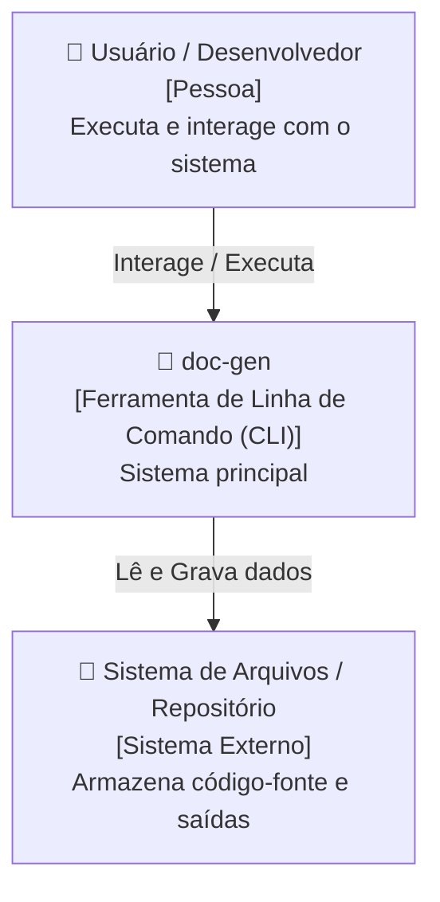

### Atores e Fronteiras
- **Usuário / Desenvolvedor**: Opera o sistema doc-gen para realizar tarefas e consultar informações.
- **doc-gen**: O software sob análise, responsável pela lógica principal, orquestração e fluxos.
- **Sistema de Arquivos / Repositório**: Provedor de entrada (código, configurações) e destino de artefatos gerados.

---

## Nível 2: Diagrama de Containers (Containers)

Containers representam as unidades executáveis ou de armazenamento independentes que compõem a solução (aplicações, bancos de dados, serviços, file systems).

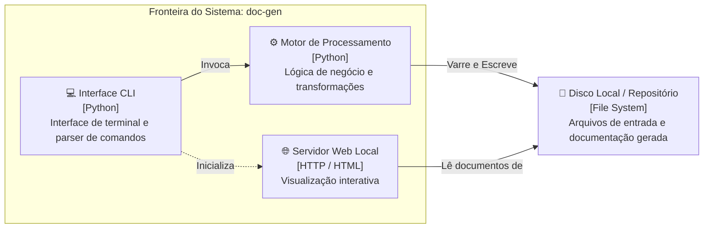

### Descrição dos Containers
| Container | Tecnologia | Responsabilidade |
|---|---|---|
| **Interface CLI** | Python / CLI | Receber argumentos do usuário, configurar modos de execução e exibir status formatado. |
| **Motor de Processamento** | Python | Analisar estruturas, parsear ASTs, compilar grafos e gerar relatórios. |
| **Servidor Web Local** | HTTP / HTML5 / JS | Servir e renderizar os documentos Markdown e diagramas interativos localmente. |
| **Disco / Storage** | File System Local | Armazenar fontes, configurações e saídas de documentação. |

---

## Nível 3: Diagrama de Componentes (Components)

Exibe a decomposição interna dos módulos de software que formam o container principal e como eles colaboram entre si.

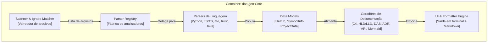

### Catálogo de Componentes Chave
- **Scanner & Ignore Matcher**: Responsável por navegar recursivamente pelos diretórios, respeitando regras do `.gitignore` e contabilizando linhas de código.
- **Parser Registry & Analyzers**: Fábrica polimórfica que seleciona o parser adequado para cada linguagem e extrai símbolos, classes, métodos e tipos.
- **Data Models**: Dataclasses imutáveis que garantem integridade estrutural em toda a pipeline.
- **Generators Suite**: Conjunto de especialistas em formatar saídas técnicas (C4, HLD, LLD, DAS, ADRs, Glossário DDD e API).

---

## Nível 4: Diagrama de Código (Code / Class Diagram)

Mapeamento das principais classes, interfaces e tipos estruturais que implementam as regras de domínio.

```mermaid
classDiagram
    class TestCLI {
        +setUp()
        +tearDown()
        +test_cli_stats()
        +test_cli_generate_multi()
    }
    unittest_TestCase <|-- TestCLI
    class TestPythonParser {
        +setUp()
        +tearDown()
        +test_parse_classes_and_methods()
        +test_parse_routes()
    }
    unittest_TestCase <|-- TestPythonParser
    class TestJsTsParser {
        +setUp()
        +tearDown()
        +test_parse_typescript_interfaces_and_classes()
        +test_parse_express_routes()
    }
    unittest_TestCase <|-- TestJsTsParser
    class TestGenerators {
        +setUp()
        +tearDown()
        +test_c4_model_generation()
        +test_hld_lld_das_generation()
    }
    unittest_TestCase <|-- TestGenerators
    class TestScanner {
        +setUp()
        +tearDown()
        +test_ignore_matcher()
        +test_detect_language()
    }
    unittest_TestCase <|-- TestScanner
    class IgnoreMatcher {
        +__init__()
        +_load_file()
        +is_ignored()
    }
    class RepositoryScanner {
        +__init__()
        +scan()
        +calculate_metrics()
        +detect_manifests()
    }
    class SymbolType {
    }
    str <|-- SymbolType
    Enum <|-- SymbolType
    class ParameterInfo {
        +formatted()
    }
    class SymbolInfo {
        +signature()
    }
    class ImportInfo {
    }
    class FileInfo {
    }
    class ModuleGroup {
    }
    class ProjectMetrics {
    }
    class UbiquitousTerm {
    }
```

---

# High-Level Design (HLD): doc-gen

> [!NOTE]
> O **High-Level Design (HLD)** documenta a arquitetura macro, o estilo arquitetural, as fronteiras do sistema e os requisitos não-funcionais que orientam a engenharia da solução.

---

## 1. Visão Geral da Solução
O projeto **doc-gen** foi projetado como uma solução modular desenvolvida principalmente em **Python**, totalizando aproximadamente **357 linhas de código** distribuídas em **31 arquivos**.

### Objetivos Principais
- Fornecer processamento confiável, previsível e desacoplado.
- Permitir fácil extensão para novas linguagens e formatos sem quebrar contratos existentes.
- Garantir portabilidade multiplataforma sem necessidade de dependências pesadas de terceiros.

## 2. Estilo Arquitetural
A solução adota uma **Arquitetura em Camadas (Layered Architecture)** combinada com o padrão **Pipeline / Filter**, onde o fluxo de dados passa por etapas sequenciais bem definidas:

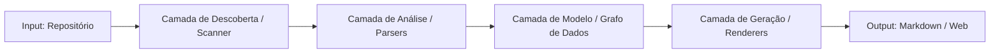

### Benefícios do Estilo Adotado
- **Separação de Responsabilidades (SoC)**: O módulo de varredura não sabe como gerar Markdown; o gerador não sabe como o AST foi extraído.
- **Testabilidade Isolada**: Cada camada pode ser testada unitariamente com fixtures e dados mockados.
- **Extensibilidade**: Novos parsers e novos geradores podem ser adicionados plugando-se nas fábricas correspondentes.

## 3. Requisitos Não-Funcionais (RNFs)
| Categoria | Requisito | Estratégia de Implementação |
|---|---|---|
| **Portabilidade** | Executar em Linux, macOS e Windows sem compilação nativa externa | Uso de módulos padrão (`pathlib`, `os`, `sys`, `ast`) compatíveis entre SOs. |
| **Performance** | Analisar repositórios em tempo inferior a poucos segundos | Otimização de varredura de diretórios com poda rápida via `.gitignore` e regex pré-compiladas. |
| **Autonomia** | Funcionamento 100% offline (Zero dependência de rede obrigatória) | Motor sintático nativo que dispensa conexões remotas ou APIs externas para gerar a documentação completa. |
| **Manutenibilidade** | Código limpo, tipado e com alta taxa de documentação | Dataclasses estritas, contratos abstratos (`BaseParser`) e modularização em submódulos. |

## 4. Integrações e Fronteiras Externas
- **Sistema Operacional & File System**: Acesso a diretórios locais com permissão de leitura/escrita.
- **Bibliotecas Externas**: Autossuficiente utilizando exclusivamente a runtime padrão.

---

# Low-Level Design (LLD): doc-gen

> [!NOTE]
> O **Low-Level Design (LLD)** detalha as estruturas de dados, assinaturas de contratos, padrões de projeto aplicados e fluxos de execução sequenciais detalhados.

---

## 1. Padrões de Projeto (Design Patterns) Aplicados

### A. Factory Method / Registry Pattern (`ParserRegistry`)
Gerencia a lista de analisadores especializados e instancia o parser correto com base na linguagem ou extensão detectada.

### B. Strategy Pattern (`BaseParser`)
Cada analisador de linguagem (`PythonParser`, `JsTsParser`, `GoParser`, `RustParser`, `JavaParser`, `GenericParser`) implementa a interface comum `BaseParser`, permitindo troca dinâmica de estratégias de parsing.

### C. Builder / Pipeline Pattern (`DocSuiteGenerator`)
Constrói a suíte completa de documentação (`INDEX`, `ARCHITECTURE`, `C4`, `HLD`, `LLD`, `DAS`, `ADRS`, `API`) passo a passo a partir do modelo unificado `ProjectData`.

## 2. Diagrama de Sequência do Fluxo de Execução

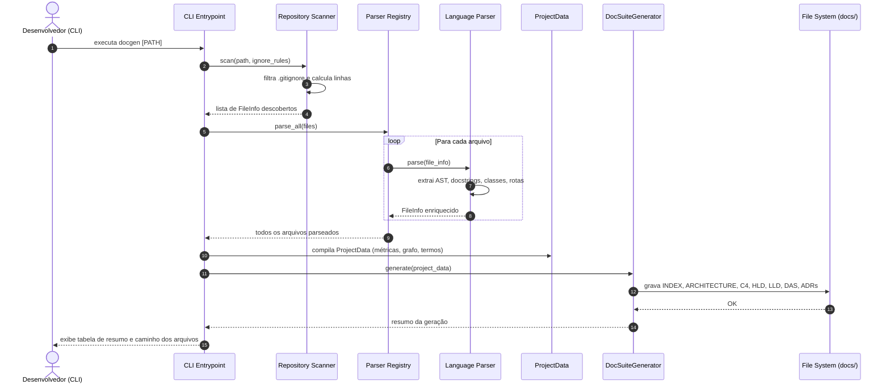

## 3. Estruturas de Dados e Entidades do Núcleo
- `FileInfo`: Encapsula caminho relativo, linguagem, contagem de linhas e lista de símbolos extraídos.
- `SymbolInfo`: Modela classes, métodos, interfaces, funções e rotas com assinaturas, docstrings e decoradores.
- `ParameterInfo`: Modela parâmetros formais, tipagem estática e valores default.
- `ProjectData`: Agrega métricas, listas de arquivos, grafos de importação e termos da linguagem ubíqua.

---

# Documento de Arquitetura de Software (DAS): doc-gen

> [!NOTE]
> Este **Documento de Arquitetura de Software (DAS)** foi estruturado com base nas melhores práticas do padrão **Arc42** e do **Modelo 4+1 Visões de Philippe Kruchten**, registrando decisões, restrições, visões de processo e de implantação.

---

## 1. Introdução e Metas Arquiteturais
O objetivo do software **doc-gen** é fornecer análise estática e geração estruturada de documentação técnica para bases de código heterogêneas.

### Metas de Qualidade Prioritárias
1. **Alta Acurácia**: Extração fidedigna de tipos, classes, funções e comentários de documentação.
2. **Velocidade de Execução**: Varredura ágil mesmo em repositórios de grande porte.
3. **Legibilidade e Riqueza Visual**: Geração de Markdown estruturado com suporte nativo a diagramas Mermaid.

## 2. Restrições e Premissas Arquiteturais
- **Runtime Principal**: Python.
- **Independência de Ambiente**: Compatibilidade direta com ambientes isolados (containers, sandboxes e pipelines de CI/CD).
- **Respeito a Políticas de Código**: Conformidade total com regras de exclusão (`.gitignore`, `.docgenignore`).

## 3. Visão Lógica (Logical View)
Mapeia a organização modular do software e como as responsabilidades são divididas entre os subsistemas:

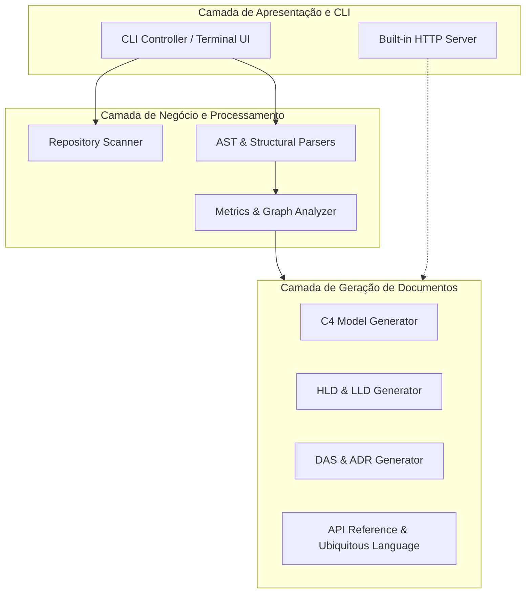

## 4. Visão de Processo (Process View)
- **Ciclo de Vida Síncrono e Determinístico**: Cada execução do pipeline opera em batch síncrono, garantindo idempotência (a mesma base de código gera o mesmo conjunto de documentações).
- **Uso de Memória**: O modelo `ProjectData` é retido em memória apenas durante o ciclo de execução e liberado após a escrita em disco.

## 5. Visão de Implantação e Execução (Deployment View)
O sistema pode ser distribuído e executado das seguintes maneiras:
1. **Executável Local**: Via CLI empacotada (`docgen`).
2. **Pipeline de CI/CD**: Executado em GitHub Actions, GitLab CI ou Jenkins para atualizar os documentos a cada pull request ou push.
3. **Container Docker**: Executável dentro de imagens base mínimas.

## 6. Riscos Arquiteturais e Mitigações
| Risco Identificado | Impacto | Estratégia de Mitigação |
|---|---|---|
| Arquivos com sintaxe inválida no repositório | Falha durante o parseamento | Parsers implementados com blocos `try/except` resilientes e fallback para `GenericParser`. |
| Repositórios gigantescos com milhões de linhas | Lentidão ou estouro de memória | Limitação de tamanho individual de arquivo (5MB) e poda de diretórios ignorados antes do parse. |
| Falta de tipagem estática no código analisado | Documentação com tipos vazios | Detecção heurística de valores default e docstrings para enriquecer assinaturas. |

---

# Linguagem Ubíqua (Glossário DDD): doc-gen

> [!NOTE]
> No **Domain-Driven Design (DDD)**, a **Linguagem Ubíqua** (Ubiquitous Language) é o vocabulário compartilhado e rigoroso utilizado tanto por especialistas de negócio quanto pela equipe técnica para eliminar ambiguidades no software.

---

## 1. Mapa Conceitual do Domínio
Relação visual dos termos mais representativos identificados na base de código:

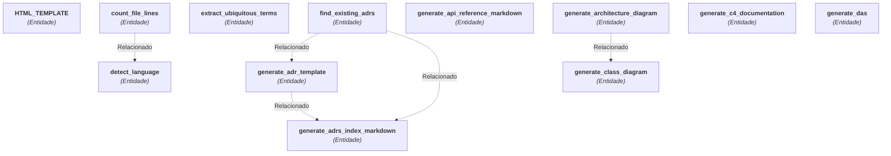

## 2. Glossário de Termos do Negócio

| Termo / Conceito | Categoria DDD | Definição / Papel no Sistema | Ocorrências |
|---|---|---|---|
| **HTML_TEMPLATE** | `Entidade` | Elemento estrutural do domínio do sistema. | `server.py` |
| **count_file_lines** | `Entidade` | Analisa as linhas de um arquivo e retorna:. | `scanner.py` |
| **detect_language** | `Entidade` | Identifica a linguagem pelo nome ou extensão do arquivo. | `scanner.py` |
| **extract_ubiquitous_terms** | `Entidade` | Analisa as definições de classes, tipos e enums para compor a Linguagem Ubíqua. | `ubiquitous_language_generator.py` |
| **find_existing_adrs** | `Entidade` | Procura por ADRs já existentes em pastas comuns. | `adr_generator.py` |
| **generate_adr_template** | `Entidade` | Gera o arquivo de template padrão para novas decisões arquiteturais. | `adr_generator.py` |
| **generate_adrs_index_markdown** | `Entidade` | Gera o índice consolidado de ADRs em Markdown. | `adr_generator.py` |
| **generate_api_reference_markdown** | `Entidade` | Gera o documento API_REFERENCE.md. | `api_reference_generator.py` |
| **generate_architecture_diagram** | `Entidade` | Gera um diagrama de arquitetura em alto nível agrupando módulos em subgraphs. | `mermaid.py` |
| **generate_c4_documentation** | `Entidade` | Gera o documento completo C4_MODEL.md. | `c4_generator.py` |
| **generate_class_diagram** | `Entidade` | Gera um diagrama de classes Mermaid para entidades e classes detectadas. | `mermaid.py` |
| **generate_das** | `Entidade` | Gera o Documento de Arquitetura de Software (DAS.md) no padrão Arc42 / 4+1 Views. | `architecture_generator.py` |
| **generate_dependency_graph** | `Entidade` | Gera o grafo de dependências internas entre módulos do projeto. | `mermaid.py` |
| **generate_directory_tree** | `Entidade` | Gera uma árvore visual de diretórios em texto/ASCII. | `doc_suite.py` |
| **generate_hld** | `Entidade` | Gera o documento High-Level Design (HLD.md). | `architecture_generator.py` |
| **generate_lld** | `Entidade` | Gera o documento Low-Level Design (LLD.md). | `architecture_generator.py` |
| **generate_ubiquitous_language_markdown** | `Entidade` | Gera o documento UBIQUITOUS_LANGUAGE.md. | `ubiquitous_language_generator.py` |
| **print_banner** | `Entidade` | Exibe o cabeçalho estilizado do DocGen. | `ui.py` |
| **print_error** | `Entidade` | Imprime erro. | `ui.py` |
| **print_info** | `Entidade` | Imprime mensagem informativa. | `ui.py` |
| **print_step** | `Entidade` | Imprime uma etapa do processo. | `ui.py` |
| **print_success** | `Entidade` | Imprime confirmação de sucesso. | `ui.py` |
| **print_table** | `Entidade` | Renderiza uma tabela formatada com bordas Unicode no terminal. | `ui.py` |
| **print_warning** | `Entidade` | Imprime aviso. | `ui.py` |
| **resolve_internal_dependencies** | `Entidade` | Mapeia os imports internos entre arquivos do projeto. | `cli.py` |
| **run_generate** | `Entidade` | Executa a análise do repositório e a geração completa da documentação. | `cli.py` |
| **run_init** | `Entidade` | Inicializa arquivos de configuração padrão. | `cli.py` |
| **run_stats** | `Entidade` | Apenas analisa e exibe métricas no terminal. | `cli.py` |
| **sanitize_id** | `Entidade` | Sanitiza strings para identificadores válidos em nós Mermaid. | `mermaid.py` |
| **start_doc_server** | `Entidade` | Inicia o servidor de visualização local. | `server.py` |
| **synthesize_project_adrs** | `Entidade` | Gera ADRs sintetizados representativos do repositório se nenhum for encontrado. | `adr_generator.py` |
| **ADRItem** | `Entidade de Domínio` | Entidade central com ciclo de vida e estado gerenciado em ADRItem. | `models.py` |
| **BaseParser** | `Entidade de Domínio` | Contrato base para analisadores de código fonte. | `base.py` |
| **Colors** | `Entidade de Domínio` | Entidade central com ciclo de vida e estado gerenciado em Colors. | `ui.py` |
| **GenericParser** | `Entidade de Domínio` | Parser de fallback para qualquer arquivo de código ou configuração. | `generic_parser.py` |
| **GoParser** | `Entidade de Domínio` | Parser estrutural para código Go. | `go_parser.py` |
| **IgnoreMatcher** | `Entidade de Domínio` | Implementa correspondência de padrões estilo .gitignore. | `scanner.py` |
| **JavaParser** | `Entidade de Domínio` | Parser para linguagens orientadas a objetos baseadas em classes (Java, C#, Kotlin). | `java_parser.py` |
| **JsTsParser** | `Entidade de Domínio` | Parser estrutural e regex para JavaScript e TypeScript. | `js_ts_parser.py` |
| **ModuleGroup** | `Entidade de Domínio` | Entidade central com ciclo de vida e estado gerenciado em ModuleGroup. | `models.py` |
| **PythonParser** | `Entidade de Domínio` | Parser para arquivos Python usando AST. | `python_parser.py` |
| **RustParser** | `Entidade de Domínio` | Parser estrutural para código Rust. | `rust_parser.py` |
| **SymbolType** | `Entidade de Domínio` | Entidade central com ciclo de vida e estado gerenciado em SymbolType. | `models.py` |
| **TestCLI** | `Entidade de Domínio` | Entidade central com ciclo de vida e estado gerenciado em TestCLI. | `test_cli.py` |
| **TestJsTsParser** | `Entidade de Domínio` | Entidade central com ciclo de vida e estado gerenciado em TestJsTsParser. | `test_js_parser.py` |
| **TestPythonParser** | `Entidade de Domínio` | Entidade central com ciclo de vida e estado gerenciado em TestPythonParser. | `test_python_parser.py` |
| **UbiquitousTerm** | `Entidade de Domínio` | Entidade central com ciclo de vida e estado gerenciado em UbiquitousTerm. | `models.py` |
| **FileInfo** | `Objeto de Valor (Value Object)` | Representação imutável com propriedades e métricas de FileInfo. | `models.py` |
| **ImportInfo** | `Objeto de Valor (Value Object)` | Representação imutável com propriedades e métricas de ImportInfo. | `models.py` |
| **ParameterInfo** | `Objeto de Valor (Value Object)` | Representação imutável com propriedades e métricas de ParameterInfo. | `models.py` |
| **ProjectData** | `Objeto de Valor (Value Object)` | Representação imutável com propriedades e métricas de ProjectData. | `models.py` |
| **ProjectMetrics** | `Objeto de Valor (Value Object)` | Representação imutável com propriedades e métricas de ProjectMetrics. | `models.py` |
| **SymbolInfo** | `Objeto de Valor (Value Object)` | Representação imutável com propriedades e métricas de SymbolInfo. | `models.py` |
| **DocSuiteGenerator** | `Serviço de Domínio` | Orquestra a escrita dos documentos Markdown. | `doc_suite.py` |
| **DocViewerHandler** | `Serviço de Domínio` | Handler HTTP para servir a UI interativa e os arquivos Markdown. | `server.py` |
| **ParserRegistry** | `Serviço de Domínio` | Gerencia a lista de parsers disponíveis e aplica o mais adequado a cada arquivo. | `__init__.py` |
| **RepositoryScanner** | `Serviço de Domínio` | Escaneia o repositório e constrói a lista inicial de arquivos e métricas. | `scanner.py` |
| **TestGenerators** | `Serviço de Domínio` | Serviço responsável por executar operações e orquestrações de TestGenerators. | `test_generators.py` |
| **TestScanner** | `Serviço de Domínio` | Serviço responsável por executar operações e orquestrações de TestScanner. | `test_scanner.py` |

---

### Entidade (31)
- **HTML_TEMPLATE**: Elemento estrutural do domínio do sistema.
  - *Arquivos*: `docgen/server.py`
- **count_file_lines**: Analisa as linhas de um arquivo e retorna:.
  - *Arquivos*: `docgen/scanner.py`
- **detect_language**: Identifica a linguagem pelo nome ou extensão do arquivo.
  - *Arquivos*: `docgen/scanner.py`
- **extract_ubiquitous_terms**: Analisa as definições de classes, tipos e enums para compor a Linguagem Ubíqua.
  - *Arquivos*: `docgen/generators/ubiquitous_language_generator.py`
- **find_existing_adrs**: Procura por ADRs já existentes em pastas comuns.
  - *Arquivos*: `docgen/generators/adr_generator.py`
- **generate_adr_template**: Gera o arquivo de template padrão para novas decisões arquiteturais.
  - *Arquivos*: `docgen/generators/adr_generator.py`
- **generate_adrs_index_markdown**: Gera o índice consolidado de ADRs em Markdown.
  - *Arquivos*: `docgen/generators/adr_generator.py`
- **generate_api_reference_markdown**: Gera o documento API_REFERENCE.md.
  - *Arquivos*: `docgen/generators/api_reference_generator.py`
- **generate_architecture_diagram**: Gera um diagrama de arquitetura em alto nível agrupando módulos em subgraphs.
  - *Arquivos*: `docgen/generators/mermaid.py`
- **generate_c4_documentation**: Gera o documento completo C4_MODEL.md.
  - *Arquivos*: `docgen/generators/c4_generator.py`
- **generate_class_diagram**: Gera um diagrama de classes Mermaid para entidades e classes detectadas.
  - *Arquivos*: `docgen/generators/mermaid.py`
- **generate_das**: Gera o Documento de Arquitetura de Software (DAS.md) no padrão Arc42 / 4+1 Views.
  - *Arquivos*: `docgen/generators/architecture_generator.py`
- **generate_dependency_graph**: Gera o grafo de dependências internas entre módulos do projeto.
  - *Arquivos*: `docgen/generators/mermaid.py`
- **generate_directory_tree**: Gera uma árvore visual de diretórios em texto/ASCII.
  - *Arquivos*: `docgen/generators/doc_suite.py`
- **generate_hld**: Gera o documento High-Level Design (HLD.md).
  - *Arquivos*: `docgen/generators/architecture_generator.py`
- **generate_lld**: Gera o documento Low-Level Design (LLD.md).
  - *Arquivos*: `docgen/generators/architecture_generator.py`
- **generate_ubiquitous_language_markdown**: Gera o documento UBIQUITOUS_LANGUAGE.md.
  - *Arquivos*: `docgen/generators/ubiquitous_language_generator.py`
- **print_banner**: Exibe o cabeçalho estilizado do DocGen.
  - *Arquivos*: `docgen/ui.py`
- **print_error**: Imprime erro.
  - *Arquivos*: `docgen/ui.py`
- **print_info**: Imprime mensagem informativa.
  - *Arquivos*: `docgen/ui.py`
- **print_step**: Imprime uma etapa do processo.
  - *Arquivos*: `docgen/ui.py`
- **print_success**: Imprime confirmação de sucesso.
  - *Arquivos*: `docgen/ui.py`
- **print_table**: Renderiza uma tabela formatada com bordas Unicode no terminal.
  - *Arquivos*: `docgen/ui.py`
- **print_warning**: Imprime aviso.
  - *Arquivos*: `docgen/ui.py`
- **resolve_internal_dependencies**: Mapeia os imports internos entre arquivos do projeto.
  - *Arquivos*: `docgen/cli.py`
- **run_generate**: Executa a análise do repositório e a geração completa da documentação.
  - *Arquivos*: `docgen/cli.py`
- **run_init**: Inicializa arquivos de configuração padrão.
  - *Arquivos*: `docgen/cli.py`
- **run_stats**: Apenas analisa e exibe métricas no terminal.
  - *Arquivos*: `docgen/cli.py`
- **sanitize_id**: Sanitiza strings para identificadores válidos em nós Mermaid.
  - *Arquivos*: `docgen/generators/mermaid.py`
- **start_doc_server**: Inicia o servidor de visualização local.
  - *Arquivos*: `docgen/server.py`
- **synthesize_project_adrs**: Gera ADRs sintetizados representativos do repositório se nenhum for encontrado.
  - *Arquivos*: `docgen/generators/adr_generator.py`

### Entidade de Domínio (16)
- **ADRItem**: Entidade central com ciclo de vida e estado gerenciado em ADRItem.
  - *Arquivos*: `docgen/models.py`
- **BaseParser**: Contrato base para analisadores de código fonte.
  - *Arquivos*: `docgen/parsers/base.py`
- **Colors**: Entidade central com ciclo de vida e estado gerenciado em Colors.
  - *Arquivos*: `docgen/ui.py`
- **GenericParser**: Parser de fallback para qualquer arquivo de código ou configuração.
  - *Arquivos*: `docgen/parsers/generic_parser.py`
- **GoParser**: Parser estrutural para código Go.
  - *Arquivos*: `docgen/parsers/go_parser.py`
- **IgnoreMatcher**: Implementa correspondência de padrões estilo .gitignore.
  - *Arquivos*: `docgen/scanner.py`
- **JavaParser**: Parser para linguagens orientadas a objetos baseadas em classes (Java, C#, Kotlin).
  - *Arquivos*: `docgen/parsers/java_parser.py`
- **JsTsParser**: Parser estrutural e regex para JavaScript e TypeScript.
  - *Arquivos*: `docgen/parsers/js_ts_parser.py`
- **ModuleGroup**: Entidade central com ciclo de vida e estado gerenciado em ModuleGroup.
  - *Arquivos*: `docgen/models.py`
- **PythonParser**: Parser para arquivos Python usando AST.
  - *Arquivos*: `docgen/parsers/python_parser.py`
- **RustParser**: Parser estrutural para código Rust.
  - *Arquivos*: `docgen/parsers/rust_parser.py`
- **SymbolType**: Entidade central com ciclo de vida e estado gerenciado em SymbolType.
  - *Arquivos*: `docgen/models.py`
- **TestCLI**: Entidade central com ciclo de vida e estado gerenciado em TestCLI.
  - *Arquivos*: `tests/test_cli.py`
- **TestJsTsParser**: Entidade central com ciclo de vida e estado gerenciado em TestJsTsParser.
  - *Arquivos*: `tests/test_js_parser.py`
- **TestPythonParser**: Entidade central com ciclo de vida e estado gerenciado em TestPythonParser.
  - *Arquivos*: `tests/test_python_parser.py`
- **UbiquitousTerm**: Entidade central com ciclo de vida e estado gerenciado em UbiquitousTerm.
  - *Arquivos*: `docgen/models.py`

### Objeto de Valor (Value Object) (6)
- **FileInfo**: Representação imutável com propriedades e métricas de FileInfo.
  - *Arquivos*: `docgen/models.py`
- **ImportInfo**: Representação imutável com propriedades e métricas de ImportInfo.
  - *Arquivos*: `docgen/models.py`
- **ParameterInfo**: Representação imutável com propriedades e métricas de ParameterInfo.
  - *Arquivos*: `docgen/models.py`
- **ProjectData**: Representação imutável com propriedades e métricas de ProjectData.
  - *Arquivos*: `docgen/models.py`
- **ProjectMetrics**: Representação imutável com propriedades e métricas de ProjectMetrics.
  - *Arquivos*: `docgen/models.py`
- **SymbolInfo**: Representação imutável com propriedades e métricas de SymbolInfo.
  - *Arquivos*: `docgen/models.py`

### Serviço de Domínio (6)
- **DocSuiteGenerator**: Orquestra a escrita dos documentos Markdown.
  - *Arquivos*: `docgen/generators/doc_suite.py`
- **DocViewerHandler**: Handler HTTP para servir a UI interativa e os arquivos Markdown.
  - *Arquivos*: `docgen/server.py`
- **ParserRegistry**: Gerencia a lista de parsers disponíveis e aplica o mais adequado a cada arquivo.
  - *Arquivos*: `docgen/parsers/__init__.py`
- **RepositoryScanner**: Escaneia o repositório e constrói a lista inicial de arquivos e métricas.
  - *Arquivos*: `docgen/scanner.py`
- **TestGenerators**: Serviço responsável por executar operações e orquestrações de TestGenerators.
  - *Arquivos*: `tests/test_generators.py`
- **TestScanner**: Serviço responsável por executar operações e orquestrações de TestScanner.
  - *Arquivos*: `tests/test_scanner.py`


---

# Registro de Decisões Arquiteturais (ADRs): doc-gen

> [!NOTE]
> **Architecture Decision Records (ADRs)** capturam decisões arquiteturais significativas tomadas ao longo da evolução do software, seus contextos e consequências.

---

## Lista de Decisões Arquiteturais Registradas

| # | Decisão | Status | Data |
|---|---|---|---|
| **ADR-001** | [Adoção da Stack Tecnológica Principal: Python](#adr-001-adoção-da-stack-tecnológica-principal:-python) | `Aceito` | 2026 |
| **ADR-002** | [Padrão Arquitetural em Camadas e Pipeline](#adr-002-padrão-arquitetural-em-camadas-e-pipeline) | `Aceito` | 2026 |
| **ADR-003** | [Estratégia Híbrida de Análise Sintática (AST + Parsing Estrutural)](#adr-003-estratégia-híbrida-de-análise-sintática-(ast-+-parsing-estrutural)) | `Aceito` | 2026 |
| **ADR-004** | [Padronização da Suíte de Documentação (C4, HLD/LLD, DAS e Linguagem Ubíqua)](#adr-004-padronização-da-suíte-de-documentação-(c4,-hld/lld,-das-e-linguagem-ubíqua)) | `Aceito` | 2026 |

---

## ADR-001: Adoção da Stack Tecnológica Principal: Python
**Status:** `Aceito` | **Data:** 2026

### Contexto
O projeto doc-gen necessita de alta confiabilidade, manutenibilidade e suporte consistente a ecossistema de desenvolvimento.

### Decisão
Padronizar o desenvolvimento do núcleo em Python, priorizando convenções consolidadas e tipagem consistente.

### Consequências
Positivo: facilidade de integração, ecossistema maduro e ampla base de conhecimento. Negativo: exige observância de boas práticas para manter o desempenho com bases volumosas.

---

## ADR-002: Padrão Arquitetural em Camadas e Pipeline
**Status:** `Aceito` | **Data:** 2026

### Contexto
Necessidade de separar as fases de entrada, descoberta, parseamento de código e geração de resultados para viabilizar testes independentes.

### Decisão
Adotar uma arquitetura orientada a Pipeline (Scanner -> Parsers -> Model -> Generators), desacoplando a camada de entrada da camada de geração.

### Consequências
Positivo: alta testabilidade, baixo acoplamento e suporte plugável a novas linguagens. Negativo: necessidade de manter um modelo de dados intermediário representativo.

---

## ADR-003: Estratégia Híbrida de Análise Sintática (AST + Parsing Estrutural)
**Status:** `Aceito` | **Data:** 2026

### Contexto
O sistema precisa analisar múltiplas linguagens (Python, TypeScript, Go, Rust, etc.) sem depender de ferramentas nativas externas pesadas.

### Decisão
Utilizar o módulo nativo AST onde disponível (ex: Python) e analisadores léxicos/estruturais robustos baseados em padrões formais para linguagens adicionais.

### Consequências
Positivo: execução ultra-rápida, zero dependências obrigatórias e compatibilidade imediata. Negativo: para sintaxes muito dinâmicas e metaprogramação, a análise foca em símbolos declarados explicitamente.

---

## ADR-004: Padronização da Suíte de Documentação (C4, HLD/LLD, DAS e Linguagem Ubíqua)
**Status:** `Aceito` | **Data:** 2026

### Contexto
Documentações puramente descritivas falham em comunicar a arquitetura de software para diferentes perfis de engenharia e liderança.

### Decisão
Padronizar a geração de documentos seguindo os padrões C4 Model, High-Level e Low-Level Design, Documento de Arquitetura de Software (DAS) e glossário de Linguagem Ubíqua (DDD).

### Consequências
Positivo: comunicação clara em múltiplos níveis de abstração (executivo, arquitetural e técnico). Negativo: volume maior de documentação gerada, mitigado pela navegação via sumário e servidor web.

---


---

# Referência de API e Símbolos: doc-gen

> [!NOTE]
> Esta seção fornece a documentação técnica detalhada das interfaces, classes, métodos, funções e rotas expostas pelo código-fonte.

---

## Módulos Documentados

| Módulo / Arquivo | Linguagem | Símbolos | SLOC |
|---|---|---|---|
| [pyproject.toml](#pyproject-toml) | TOML | 0 | 22 |
| [setup.py](#setup-py) | Python | 0 | 11 |
| [.gitignore](#-gitignore) | Other | 0 | 30 |
| [tests/test_cli.py](#tests-test_cli-py) | Python | 1 | 0 |
| [tests/test_python_parser.py](#tests-test_python_parser-py) | Python | 1 | 0 |
| [tests/test_js_parser.py](#tests-test_js_parser-py) | Python | 1 | 12 |
| [tests/test_generators.py](#tests-test_generators-py) | Python | 1 | 0 |
| [tests/test_scanner.py](#tests-test_scanner-py) | Python | 1 | 0 |
| [docgen/scanner.py](#docgen-scanner-py) | Python | 4 | 126 |
| [docgen/cli.py](#docgen-cli-py) | Python | 5 | 0 |
| [docgen/models.py](#docgen-models-py) | Python | 10 | 0 |
| [docgen/server.py](#docgen-server-py) | Python | 3 | 0 |
| [docgen/ui.py](#docgen-ui-py) | Python | 8 | 0 |
| [docgen/generators/c4_generator.py](#docgen-generators-c4_generator-py) | Python | 1 | 0 |
| [docgen/generators/ubiquitous_language_generator.py](#docgen-generators-ubiquitous_language_generator-py) | Python | 2 | 0 |
| [docgen/generators/api_reference_generator.py](#docgen-generators-api_reference_generator-py) | Python | 1 | 0 |
| [docgen/generators/adr_generator.py](#docgen-generators-adr_generator-py) | Python | 4 | 0 |
| [docgen/generators/doc_suite.py](#docgen-generators-doc_suite-py) | Python | 2 | 0 |
| [docgen/generators/mermaid.py](#docgen-generators-mermaid-py) | Python | 4 | 0 |
| [docgen/generators/architecture_generator.py](#docgen-generators-architecture_generator-py) | Python | 3 | 0 |
| [docgen/parsers/base.py](#docgen-parsers-base-py) | Python | 1 | 0 |
| [docgen/parsers/js_ts_parser.py](#docgen-parsers-js_ts_parser-py) | Python | 1 | 48 |
| [docgen/parsers/go_parser.py](#docgen-parsers-go_parser-py) | Python | 1 | 0 |
| [docgen/parsers/rust_parser.py](#docgen-parsers-rust_parser-py) | Python | 1 | 0 |
| [docgen/parsers/java_parser.py](#docgen-parsers-java_parser-py) | Python | 1 | 85 |
| [docgen/parsers/generic_parser.py](#docgen-parsers-generic_parser-py) | Python | 1 | 23 |
| [docgen/parsers/python_parser.py](#docgen-parsers-python_parser-py) | Python | 3 | 0 |
| [docgen/parsers/__init__.py](#docgen-parsers-__init__-py) | Python | 1 | 0 |

---

<a id='pyproject-toml'></a>
## Arquivo: `pyproject.toml`
**Linguagem:** TOML | **Linhas de Código:** 22 | **Comentários:** 0

*Nenhum símbolo estruturado (funções ou classes) declarado diretamente neste arquivo.*

---

<a id='setup-py'></a>
## Arquivo: `setup.py`
**Linguagem:** Python | **Linhas de Código:** 11 | **Comentários:** 0

*Nenhum símbolo estruturado (funções ou classes) declarado diretamente neste arquivo.*

---

<a id='-gitignore'></a>
## Arquivo: `.gitignore`
**Linguagem:** Other | **Linhas de Código:** 30 | **Comentários:** 4

### Descrição do Módulo
> Python

*Nenhum símbolo estruturado (funções ou classes) declarado diretamente neste arquivo.*

---

<a id='tests-test_cli-py'></a>
## Arquivo: `tests/test_cli.py`
**Linguagem:** Python | **Linhas de Código:** 0 | **Comentários:** 43

### Descrição do Módulo
> Testes unitários para os comandos da CLI do DocGen.

### `class` TestCLI
```python
class TestCLI(unittest.TestCase)
```

#### Métodos da Classe
- **`setUp`**`()`
- **`tearDown`**`()`
- **`test_cli_stats`**`()`
- **`test_cli_generate_multi`**`()`
- **`test_cli_generate_single_file`**`()`

---

<a id='tests-test_python_parser-py'></a>
## Arquivo: `tests/test_python_parser.py`
**Linguagem:** Python | **Linhas de Código:** 0 | **Comentários:** 73

### Descrição do Módulo
> Testes unitários para o analisador de código Python via AST.

### `class` TestPythonParser
```python
class TestPythonParser(unittest.TestCase)
```

#### Métodos da Classe
- **`setUp`**`()`
- **`tearDown`**`()`
- **`test_parse_classes_and_methods`**`()`
- **`test_parse_routes`**`()`

---

<a id='tests-test_js_parser-py'></a>
## Arquivo: `tests/test_js_parser.py`
**Linguagem:** Python | **Linhas de Código:** 12 | **Comentários:** 74

### Descrição do Módulo
> Testes unitários para o analisador de código JavaScript e TypeScript.

### `class` TestJsTsParser
```python
class TestJsTsParser(unittest.TestCase)
```

#### Métodos da Classe
- **`setUp`**`()`
- **`tearDown`**`()`
- **`test_parse_typescript_interfaces_and_classes`**`()`
- **`test_parse_express_routes`**`()`

---

<a id='tests-test_generators-py'></a>
## Arquivo: `tests/test_generators.py`
**Linguagem:** Python | **Linhas de Código:** 0 | **Comentários:** 157

### Descrição do Módulo
> Testes unitários para todos os geradores de documentação técnica e arquitetural:
- C4 Model
- HLD / LLD / DAS
- ADRs
- Linguagem Ubíqua (DDD)
- DocSuiteGenerator (Multi e Single-file)

### `class` TestGenerators
```python
class TestGenerators(unittest.TestCase)
```

#### Métodos da Classe
- **`setUp`**`()`
- **`tearDown`**`()`
- **`test_c4_model_generation`**`()`
- **`test_hld_lld_das_generation`**`()`
- **`test_adr_generation`**`()`
- **`test_ubiquitous_language_generation`**`()`
- **`test_doc_suite_generator_multi_file`**`()`
- **`test_doc_suite_generator_single_file`**`()`

---

<a id='tests-test_scanner-py'></a>
## Arquivo: `tests/test_scanner.py`
**Linguagem:** Python | **Linhas de Código:** 0 | **Comentários:** 59

### Descrição do Módulo
> Testes unitários para o scanner de repositório e o gerenciador de ignores.

### `class` TestScanner
```python
class TestScanner(unittest.TestCase)
```

#### Métodos da Classe
- **`setUp`**`()`
- **`tearDown`**`()`
- **`test_ignore_matcher`**`()`
- **`test_detect_language`**`()`
- **`test_count_file_lines`**`()`
- **`test_repository_scanner_and_metrics`**`()`

---

<a id='docgen-scanner-py'></a>
## Arquivo: `docgen/scanner.py`
**Linguagem:** Python | **Linhas de Código:** 126 | **Comentários:** 187

### Descrição do Módulo
> Scanner de repositório e analisador de arquivos.
Varre a árvore de diretórios respeitando regras do .gitignore,
calcula linhas de código (SLOC), comentários e identifica manifests.

### `class` IgnoreMatcher
```python
class IgnoreMatcher
```

Implementa correspondência de padrões estilo .gitignore.

#### Métodos da Classe
- **`__init__`**`(root_dir, custom_patterns)`
- **`_load_file`**`(filepath)` -> `None`
- **`is_ignored`**`(path)` -> `bool`
  - *Verifica se um determinado Path deve ser ignorado.*

### `function` detect_language
```python
detect_language(path: Path) -> str
```

Identifica a linguagem pelo nome ou extensão do arquivo.

#### Parâmetros
| Nome | Tipo | Default |
|---|---|---|
| `path` | `Path` | - |

### `function` count_file_lines
```python
count_file_lines(path: Path, language: str) -> Tuple[int, int, int, int]
```

Analisa as linhas de um arquivo e retorna:
(total_lines, code_lines, comment_lines, blank_lines)

#### Parâmetros
| Nome | Tipo | Default |
|---|---|---|
| `path` | `Path` | - |
| `language` | `str` | - |

### `class` RepositoryScanner
```python
class RepositoryScanner
```

Escaneia o repositório e constrói a lista inicial de arquivos e métricas.

#### Métodos da Classe
- **`__init__`**`(root_dir, custom_ignores)`
- **`scan`**`()` -> `List[FileInfo]`
  - *Varre o repositório retornando FileInfo para todos os arquivos válidos.*
- **`calculate_metrics`**`(files)` -> `ProjectMetrics`
  - *Gera as métricas agregadas do projeto.*
- **`detect_manifests`**`()` -> `Tuple[Dict[str, str], List[str]]`
  - *Localiza manifests e extrai lista de dependências externas.*

---

<a id='docgen-cli-py'></a>
## Arquivo: `docgen/cli.py`
**Linguagem:** Python | **Linhas de Código:** 0 | **Comentários:** 189

### Descrição do Módulo
> Ponto de entrada da CLI do DocGen.
Orquestra a varredura, análise sintática, extração de conceitos e escrita dos Markdowns.

### `function` resolve_internal_dependencies
```python
resolve_internal_dependencies(files: List[FileInfo]) -> Dict[str, List[str]]
```

Mapeia os imports internos entre arquivos do projeto.

#### Parâmetros
| Nome | Tipo | Default |
|---|---|---|
| `files` | `List[FileInfo]` | - |

### `function` run_generate
```python
run_generate(args: argparse.Namespace) -> int
```

Executa a análise do repositório e a geração completa da documentação.

#### Parâmetros
| Nome | Tipo | Default |
|---|---|---|
| `args` | `argparse.Namespace` | - |

### `function` run_stats
```python
run_stats(args: argparse.Namespace) -> int
```

Apenas analisa e exibe métricas no terminal.

#### Parâmetros
| Nome | Tipo | Default |
|---|---|---|
| `args` | `argparse.Namespace` | - |

### `function` run_init
```python
run_init(args: argparse.Namespace) -> int
```

Inicializa arquivos de configuração padrão.

#### Parâmetros
| Nome | Tipo | Default |
|---|---|---|
| `args` | `argparse.Namespace` | - |

### `function` main
```python
main(argv = None)
```

#### Parâmetros
| Nome | Tipo | Default |
|---|---|---|
| `argv` | *any* | `None` |

---

<a id='docgen-models-py'></a>
## Arquivo: `docgen/models.py`
**Linguagem:** Python | **Linhas de Código:** 0 | **Comentários:** 133

### Descrição do Módulo
> Modelos de dados (dataclasses) para o DocGen.
Representa símbolos, arquivos, módulos, métricas, diagramas e termos de domínio.

### `class` SymbolType
```python
class SymbolType(str, Enum)
```

### `class` ParameterInfo
```python
@dataclass
class ParameterInfo
```

#### Métodos da Classe
- **`formatted`**`()` -> `str`

### `class` SymbolInfo
```python
@dataclass
class SymbolInfo
```

#### Métodos da Classe
- **`signature`**`()` -> `str`
  - *Retorna uma assinatura formatada e legível.*

### `class` ImportInfo
```python
@dataclass
class ImportInfo
```

### `class` FileInfo
```python
@dataclass
class FileInfo
```

### `class` ModuleGroup
```python
@dataclass
class ModuleGroup
```

### `class` ProjectMetrics
```python
@dataclass
class ProjectMetrics
```

### `class` UbiquitousTerm
```python
@dataclass
class UbiquitousTerm
```

### `class` ADRItem
```python
@dataclass
class ADRItem
```

### `class` ProjectData
```python
@dataclass
class ProjectData
```

---

<a id='docgen-server-py'></a>
## Arquivo: `docgen/server.py`
**Linguagem:** Python | **Linhas de Código:** 0 | **Comentários:** 278

### Descrição do Módulo
> Servidor HTTP embutido com visualizador interativo moderno de Markdown e Mermaid.
Zero dependências externas: utiliza http.server da biblioteca padrão.

### `constant` HTML_TEMPLATE
```python
HTML_TEMPLATE()
```

### `class` DocViewerHandler
```python
class DocViewerHandler(BaseHTTPRequestHandler)
```

Handler HTTP para servir a UI interativa e os arquivos Markdown.

#### Métodos da Classe
- **`do_GET`**`()`

### `function` start_doc_server
```python
start_doc_server(docs_path: str = 'docs', port: int = 8080)
```

Inicia o servidor de visualização local.

#### Parâmetros
| Nome | Tipo | Default |
|---|---|---|
| `docs_path` | `str` | `'docs'` |
| `port` | `int` | `8080` |

---

<a id='docgen-ui-py'></a>
## Arquivo: `docgen/ui.py`
**Linguagem:** Python | **Linhas de Código:** 0 | **Comentários:** 85

### Descrição do Módulo
> Terminal UI com cores ANSI, tabelas formatadas e indicadores visuais elegantes sem dependências externas.

### `class` Colors
```python
class Colors
```

### `function` print_banner
```python
print_banner()
```

Exibe o cabeçalho estilizado do DocGen.

### `function` print_step
```python
print_step(title: str, status: str = '...', end: str = '\n')
```

Imprime uma etapa do processo.

#### Parâmetros
| Nome | Tipo | Default |
|---|---|---|
| `title` | `str` | - |
| `status` | `str` | `'...'` |
| `end` | `str` | `'\n'` |

### `function` print_success
```python
print_success(title: str)
```

Imprime confirmação de sucesso.

#### Parâmetros
| Nome | Tipo | Default |
|---|---|---|
| `title` | `str` | - |

### `function` print_info
```python
print_info(message: str)
```

Imprime mensagem informativa.

#### Parâmetros
| Nome | Tipo | Default |
|---|---|---|
| `message` | `str` | - |

### `function` print_warning
```python
print_warning(message: str)
```

Imprime aviso.

#### Parâmetros
| Nome | Tipo | Default |
|---|---|---|
| `message` | `str` | - |

### `function` print_error
```python
print_error(message: str)
```

Imprime erro.

#### Parâmetros
| Nome | Tipo | Default |
|---|---|---|
| `message` | `str` | - |

### `function` print_table
```python
print_table(headers: List[str], rows: List[List[Any]], title: str = '')
```

Renderiza uma tabela formatada com bordas Unicode no terminal.

#### Parâmetros
| Nome | Tipo | Default |
|---|---|---|
| `headers` | `List[str]` | - |
| `rows` | `List[List[Any]]` | - |
| `title` | `str` | `''` |

---

<a id='docgen-generators-c4_generator-py'></a>
## Arquivo: `docgen/generators/c4_generator.py`
**Linguagem:** Python | **Linhas de Código:** 0 | **Comentários:** 153

### Descrição do Módulo
> Gerador de documentação no Modelo C4 (Contexto, Containers, Componentes e Código).
Gera diagramas Mermaid e detalhamento textual baseado na arquitetura de Simon Brown.

### `function` generate_c4_documentation
```python
generate_c4_documentation(project: ProjectData, lang: str = 'pt') -> str
```

Gera o documento completo C4_MODEL.md.

#### Parâmetros
| Nome | Tipo | Default |
|---|---|---|
| `project` | `ProjectData` | - |
| `lang` | `str` | `'pt'` |

---

<a id='docgen-generators-ubiquitous_language_generator-py'></a>
## Arquivo: `docgen/generators/ubiquitous_language_generator.py`
**Linguagem:** Python | **Linhas de Código:** 0 | **Comentários:** 116

### Descrição do Módulo
> Gerador de Linguagem Ubíqua (Ubiquitous Language / Glossário de Domínio - DDD).
Extrai conceitos centrais do negócio, entidades, value objects, enums e operações do código.

### `function` extract_ubiquitous_terms
```python
extract_ubiquitous_terms(project: ProjectData) -> List[UbiquitousTerm]
```

Analisa as definições de classes, tipos e enums para compor a Linguagem Ubíqua.

#### Parâmetros
| Nome | Tipo | Default |
|---|---|---|
| `project` | `ProjectData` | - |

### `function` generate_ubiquitous_language_markdown
```python
generate_ubiquitous_language_markdown(project: ProjectData, lang: str = 'pt') -> str
```

Gera o documento UBIQUITOUS_LANGUAGE.md.

#### Parâmetros
| Nome | Tipo | Default |
|---|---|---|
| `project` | `ProjectData` | - |
| `lang` | `str` | `'pt'` |

---

<a id='docgen-generators-api_reference_generator-py'></a>
## Arquivo: `docgen/generators/api_reference_generator.py`
**Linguagem:** Python | **Linhas de Código:** 0 | **Comentários:** 85

### Descrição do Módulo
> Gerador de referência de API e catálogo detalhado de classes, métodos e funções.

### `function` generate_api_reference_markdown
```python
generate_api_reference_markdown(project: ProjectData, lang: str = 'pt') -> str
```

Gera o documento API_REFERENCE.md.

#### Parâmetros
| Nome | Tipo | Default |
|---|---|---|
| `project` | `ProjectData` | - |
| `lang` | `str` | `'pt'` |

---

<a id='docgen-generators-adr_generator-py'></a>
## Arquivo: `docgen/generators/adr_generator.py`
**Linguagem:** Python | **Linhas de Código:** 0 | **Comentários:** 145

### Descrição do Módulo
> Gerador e catalogador de ADRs (Architecture Decision Records).
Lê ADRs existentes ou sintetiza decisões técnicas chave no formato padrão de Michael Nygard.

### `function` find_existing_adrs
```python
find_existing_adrs(root_path: Path) -> List[ADRItem]
```

Procura por ADRs já existentes em pastas comuns.

#### Parâmetros
| Nome | Tipo | Default |
|---|---|---|
| `root_path` | `Path` | - |

### `function` synthesize_project_adrs
```python
synthesize_project_adrs(project: ProjectData) -> List[ADRItem]
```

Gera ADRs sintetizados representativos do repositório se nenhum for encontrado.

#### Parâmetros
| Nome | Tipo | Default |
|---|---|---|
| `project` | `ProjectData` | - |

### `function` generate_adr_template
```python
generate_adr_template() -> str
```

Gera o arquivo de template padrão para novas decisões arquiteturais.

### `function` generate_adrs_index_markdown
```python
generate_adrs_index_markdown(adrs: List[ADRItem], pname: str) -> str
```

Gera o índice consolidado de ADRs em Markdown.

#### Parâmetros
| Nome | Tipo | Default |
|---|---|---|
| `adrs` | `List[ADRItem]` | - |
| `pname` | `str` | - |

---

<a id='docgen-generators-doc_suite-py'></a>
## Arquivo: `docgen/generators/doc_suite.py`
**Linguagem:** Python | **Linhas de Código:** 0 | **Comentários:** 256

### Descrição do Módulo
> Orquestrador central de geração da suíte de documentação Markdown.
Coordena a criação de todos os artefatos técnicos, suportando modo multi-arquivos ou consolidado (--single-file).

### `function` generate_directory_tree
```python
generate_directory_tree(files: List[str], max_depth: int = 3) -> str
```

Gera uma árvore visual de diretórios em texto/ASCII.

#### Parâmetros
| Nome | Tipo | Default |
|---|---|---|
| `files` | `List[str]` | - |
| `max_depth` | `int` | `3` |

### `class` DocSuiteGenerator
```python
class DocSuiteGenerator
```

Orquestra a escrita dos documentos Markdown.

#### Métodos da Classe
- **`__init__`**`(project_data, output_dir, lang)`
- **`generate_all`**`(single_file, single_file_name)` -> `List[str]`
  - *Gera todos os arquivos e retorna a lista de caminhos gravados.*
- **`_build_index`**`()` -> `str`
- **`_build_architecture`**`()` -> `str`
- **`_build_dependencies`**`()` -> `str`
- **`_build_metrics`**`()` -> `str`
- **`_build_consolidated_documentation`**`()` -> `str`
  - *Gera um único arquivo DOCUMENTATION.md contendo todas as seções.*

---

<a id='docgen-generators-mermaid-py'></a>
## Arquivo: `docgen/generators/mermaid.py`
**Linguagem:** Python | **Linhas de Código:** 0 | **Comentários:** 87

### Descrição do Módulo
> Gerador de diagramas Mermaid para arquitetura, componentes, dependências e classes.

### `function` sanitize_id
```python
sanitize_id(text: str) -> str
```

Sanitiza strings para identificadores válidos em nós Mermaid.

#### Parâmetros
| Nome | Tipo | Default |
|---|---|---|
| `text` | `str` | - |

### `function` generate_architecture_diagram
```python
generate_architecture_diagram(project: ProjectData) -> str
```

Gera um diagrama de arquitetura em alto nível agrupando módulos em subgraphs.

#### Parâmetros
| Nome | Tipo | Default |
|---|---|---|
| `project` | `ProjectData` | - |

### `function` generate_class_diagram
```python
generate_class_diagram(files: List[FileInfo]) -> str
```

Gera um diagrama de classes Mermaid para entidades e classes detectadas.

#### Parâmetros
| Nome | Tipo | Default |
|---|---|---|
| `files` | `List[FileInfo]` | - |

### `function` generate_dependency_graph
```python
generate_dependency_graph(internal_deps: Dict[str, List[str]]) -> str
```

Gera o grafo de dependências internas entre módulos do projeto.

#### Parâmetros
| Nome | Tipo | Default |
|---|---|---|
| `internal_deps` | `Dict[str, List[str]]` | - |

---

<a id='docgen-generators-architecture_generator-py'></a>
## Arquivo: `docgen/generators/architecture_generator.py`
**Linguagem:** Python | **Linhas de Código:** 0 | **Comentários:** 207

### Descrição do Módulo
> Gerador de documentação arquitetural avançada:
- HLD (High-Level Design)
- LLD (Low-Level Design)
- DAS (Documento de Arquitetura de Software / Modelo 4+1 & Arc42)

### `function` generate_hld
```python
generate_hld(project: ProjectData, lang: str = 'pt') -> str
```

Gera o documento High-Level Design (HLD.md).

#### Parâmetros
| Nome | Tipo | Default |
|---|---|---|
| `project` | `ProjectData` | - |
| `lang` | `str` | `'pt'` |

### `function` generate_lld
```python
generate_lld(project: ProjectData, lang: str = 'pt') -> str
```

Gera o documento Low-Level Design (LLD.md).

#### Parâmetros
| Nome | Tipo | Default |
|---|---|---|
| `project` | `ProjectData` | - |
| `lang` | `str` | `'pt'` |

### `function` generate_das
```python
generate_das(project: ProjectData, lang: str = 'pt') -> str
```

Gera o Documento de Arquitetura de Software (DAS.md) no padrão Arc42 / 4+1 Views.

#### Parâmetros
| Nome | Tipo | Default |
|---|---|---|
| `project` | `ProjectData` | - |
| `lang` | `str` | `'pt'` |

---

<a id='docgen-parsers-base-py'></a>
## Arquivo: `docgen/parsers/base.py`
**Linguagem:** Python | **Linhas de Código:** 0 | **Comentários:** 18

### Descrição do Módulo
> Classe base para parsers de linguagem do DocGen.

### `class` BaseParser
```python
class BaseParser(ABC)
```

Contrato base para analisadores de código fonte.

#### Métodos da Classe
- **`can_parse`**`(file_info)` -> `bool`
  - *Retorna True se o parser suporta o arquivo informado.*
- **`parse`**`(file_info)` -> `FileInfo`
  - *Executa a análise sintática e semântica do arquivo,*

---

<a id='docgen-parsers-js_ts_parser-py'></a>
## Arquivo: `docgen/parsers/js_ts_parser.py`
**Linguagem:** Python | **Linhas de Código:** 48 | **Comentários:** 221

### Descrição do Módulo
> Parser para JavaScript e TypeScript (incluindo TSX/JSX).
Extrai classes, interfaces, tipos, funções, imports, exports, JSDoc e rotas Express/Next.js.

### `class` JsTsParser
```python
class JsTsParser(BaseParser)
```

Parser estrutural e regex para JavaScript e TypeScript.

#### Métodos da Classe
- **`can_parse`**`(file_info)` -> `bool`
- **`parse`**`(file_info)` -> `FileInfo`
- **`_extract_imports`**`(content, file_info)` -> `None`
  - *Extrai declarações import e require.*
- **`_extract_jsdocs`**`(content)` -> `dict[int, str]`
  - *Associa blocos de comentário JSDoc à linha subsequente de código.*
- **`_parse_ts_params`**`(raw)` -> `List[ParameterInfo]`
  - *Faz o parse de parâmetros tipados de TypeScript/JavaScript.*

---

<a id='docgen-parsers-go_parser-py'></a>
## Arquivo: `docgen/parsers/go_parser.py`
**Linguagem:** Python | **Linhas de Código:** 0 | **Comentários:** 147

### Descrição do Módulo
> Parser para a linguagem Go.
Extrai pacotes, structs, interfaces, funções, métodos (com receivers) e imports.

### `class` GoParser
```python
class GoParser(BaseParser)
```

Parser estrutural para código Go.

#### Métodos da Classe
- **`can_parse`**`(file_info)` -> `bool`
- **`parse`**`(file_info)` -> `FileInfo`
- **`_extract_imports`**`(content, file_info)` -> `None`
- **`_parse_go_params`**`(raw)` -> `list[ParameterInfo]`

---

<a id='docgen-parsers-rust_parser-py'></a>
## Arquivo: `docgen/parsers/rust_parser.py`
**Linguagem:** Python | **Linhas de Código:** 0 | **Comentários:** 128

### Descrição do Módulo
> Parser para a linguagem Rust.
Extrai structs, enums, traits, blocos impl, funções e comentários rustdoc (///).

### `class` RustParser
```python
class RustParser(BaseParser)
```

Parser estrutural para código Rust.

#### Métodos da Classe
- **`can_parse`**`(file_info)` -> `bool`
- **`parse`**`(file_info)` -> `FileInfo`
- **`_parse_rust_params`**`(raw)` -> `list[ParameterInfo]`

---

<a id='docgen-parsers-java_parser-py'></a>
## Arquivo: `docgen/parsers/java_parser.py`
**Linguagem:** Python | **Linhas de Código:** 85 | **Comentários:** 46

### Descrição do Módulo
> Parser para Java, C# e Kotlin.
Extrai classes, interfaces, records, métodos, anotações e comentários Javadoc.

### `class` JavaParser
```python
class JavaParser(BaseParser)
```

Parser para linguagens orientadas a objetos baseadas em classes (Java, C#, Kotlin).

#### Métodos da Classe
- **`can_parse`**`(file_info)` -> `bool`
- **`parse`**`(file_info)` -> `FileInfo`
- **`_parse_params`**`(raw)` -> `list[ParameterInfo]`

---

<a id='docgen-parsers-generic_parser-py'></a>
## Arquivo: `docgen/parsers/generic_parser.py`
**Linguagem:** Python | **Linhas de Código:** 23 | **Comentários:** 26

### Descrição do Módulo
> Parser genérico para arquivos de configuração, scripts shell, SQL, Dockerfile, etc.
Extrai comentários de cabeçalho, instruções principais e variáveis.

### `class` GenericParser
```python
class GenericParser(BaseParser)
```

Parser de fallback para qualquer arquivo de código ou configuração.

#### Métodos da Classe
- **`can_parse`**`(file_info)` -> `bool`
- **`parse`**`(file_info)` -> `FileInfo`

---

<a id='docgen-parsers-python_parser-py'></a>
## Arquivo: `docgen/parsers/python_parser.py`
**Linguagem:** Python | **Linhas de Código:** 0 | **Comentários:** 180

### Descrição do Módulo
> Parser de código Python utilizando o módulo AST nativo.
Extrai classes, herança, métodos, funções, decoradores, anotações de tipo e imports.

### `function` _format_annotation
```python
_format_annotation(node: Optional[ast.AST]) -> str
```

Converte um nó AST de anotação de tipo em string legível.

#### Parâmetros
| Nome | Tipo | Default |
|---|---|---|
| `node` | `Optional[ast.AST]` | - |

### `function` _format_decorator
```python
_format_decorator(node: ast.AST) -> str
```

Converte um nó AST de decorador em string.

#### Parâmetros
| Nome | Tipo | Default |
|---|---|---|
| `node` | `ast.AST` | - |

### `class` PythonParser
```python
class PythonParser(BaseParser)
```

Parser para arquivos Python usando AST.

#### Métodos da Classe
- **`can_parse`**`(file_info)` -> `bool`
- **`parse`**`(file_info)` -> `FileInfo`
- **`_extract_import`**`(node, file_info)` -> `None`
- **`_extract_class`**`(node)` -> `SymbolInfo`
- **`_extract_function`**`(node, is_method)` -> `SymbolInfo`

---

<a id='docgen-parsers-__init__-py'></a>
## Arquivo: `docgen/parsers/__init__.py`
**Linguagem:** Python | **Linhas de Código:** 0 | **Comentários:** 35

### Descrição do Módulo
> Registro e orquestração de parsers de código.

### `class` ParserRegistry
```python
class ParserRegistry
```

Gerencia a lista de parsers disponíveis e aplica o mais adequado a cada arquivo.

#### Métodos da Classe
- **`__init__`**`()`
- **`parse_file`**`(file_info)` -> `FileInfo`
  - *Aplica o primeiro parser que aceitar o arquivo.*
- **`parse_all`**`(files)` -> `List[FileInfo]`
  - *Processa todos os arquivos da lista.*

---


---

# Dependências do Projeto: doc-gen

## Grafo de Dependências Internas
```mermaid
graph LR
    tests_test_cli_py["test_cli.py"] --> docgen_cli_py["cli.py"]
    tests_test_python_parser_py["test_python_parser.py"] --> docgen_models_py["models.py"]
    tests_test_python_parser_py["test_python_parser.py"] --> docgen_parsers_python_parser_py["python_parser.py"]
    tests_test_js_parser_py["test_js_parser.py"] --> docgen_models_py["models.py"]
    tests_test_js_parser_py["test_js_parser.py"] --> docgen_parsers_js_ts_parser_py["js_ts_parser.py"]
    tests_test_generators_py["test_generators.py"] --> docgen_models_py["models.py"]
    tests_test_generators_py["test_generators.py"] --> docgen_generators_c4_generator_py["c4_generator.py"]
    tests_test_generators_py["test_generators.py"] --> docgen_generators_architecture_generator_py["architecture_generator.py"]
    tests_test_generators_py["test_generators.py"] --> docgen_generators_adr_generator_py["adr_generator.py"]
    tests_test_generators_py["test_generators.py"] --> docgen_generators_ubiquitous_language_generator_py["ubiquitous_language_generator.py"]
    tests_test_generators_py["test_generators.py"] --> docgen_generators_doc_suite_py["doc_suite.py"]
    tests_test_scanner_py["test_scanner.py"] --> docgen_scanner_py["scanner.py"]
    tests_test_scanner_py["test_scanner.py"] --> docgen_models_py["models.py"]
    docgen_scanner_py["scanner.py"] --> docgen_config_py["config.py"]
    docgen_scanner_py["scanner.py"] --> docgen_models_py["models.py"]
    docgen___main___py["__main__.py"] --> docgen_cli_py["cli.py"]
    docgen_cli_py["cli.py"] --> docgen_scanner_py["scanner.py"]
    docgen_cli_py["cli.py"] --> docgen___main___py["__main__.py"]
    docgen_cli_py["cli.py"] --> docgen_models_py["models.py"]
    docgen_cli_py["cli.py"] --> docgen_config_py["config.py"]
    docgen_cli_py["cli.py"] --> docgen_server_py["server.py"]
    docgen_cli_py["cli.py"] --> docgen_ui_py["ui.py"]
    docgen_cli_py["cli.py"] --> docgen___init___py["__init__.py"]
    docgen_cli_py["cli.py"] --> docgen_generators_c4_generator_py["c4_generator.py"]
    docgen_cli_py["cli.py"] --> docgen_generators_ubiquitous_language_generator_py["ubiquitous_language_generator.py"]
    docgen_cli_py["cli.py"] --> docgen_generators_api_reference_generator_py["api_reference_generator.py"]
    docgen_cli_py["cli.py"] --> docgen_generators_adr_generator_py["adr_generator.py"]
    docgen_cli_py["cli.py"] --> docgen_generators_doc_suite_py["doc_suite.py"]
    docgen_cli_py["cli.py"] --> docgen_generators_mermaid_py["mermaid.py"]
    docgen_cli_py["cli.py"] --> docgen_generators_architecture_generator_py["architecture_generator.py"]
    docgen_cli_py["cli.py"] --> docgen_parsers_base_py["base.py"]
    docgen_cli_py["cli.py"] --> docgen_parsers_js_ts_parser_py["js_ts_parser.py"]
    docgen_cli_py["cli.py"] --> docgen_parsers_go_parser_py["go_parser.py"]
    docgen_cli_py["cli.py"] --> docgen_parsers_rust_parser_py["rust_parser.py"]
    docgen_cli_py["cli.py"] --> docgen_parsers_java_parser_py["java_parser.py"]
    docgen_cli_py["cli.py"] --> docgen_parsers_generic_parser_py["generic_parser.py"]
    docgen_cli_py["cli.py"] --> docgen_parsers_python_parser_py["python_parser.py"]
    docgen_cli_py["cli.py"] --> docgen_parsers___init___py["__init__.py"]
    docgen_server_py["server.py"] --> docgen_ui_py["ui.py"]
    docgen_generators_c4_generator_py["c4_generator.py"] --> docgen_models_py["models.py"]
    docgen_generators_c4_generator_py["c4_generator.py"] --> docgen_generators_mermaid_py["mermaid.py"]
    docgen_generators_ubiquitous_language_generator_py["ubiquitous_language_generator.py"] --> docgen_models_py["models.py"]
    docgen_generators_ubiquitous_language_generator_py["ubiquitous_language_generator.py"] --> docgen_generators_mermaid_py["mermaid.py"]
    docgen_generators_api_reference_generator_py["api_reference_generator.py"] --> docgen_models_py["models.py"]
    docgen_generators_adr_generator_py["adr_generator.py"] --> docgen_models_py["models.py"]
    docgen_generators_doc_suite_py["doc_suite.py"] --> docgen_models_py["models.py"]
    docgen_generators_doc_suite_py["doc_suite.py"] --> docgen_generators_mermaid_py["mermaid.py"]
    docgen_generators_doc_suite_py["doc_suite.py"] --> docgen_generators_c4_generator_py["c4_generator.py"]
    docgen_generators_doc_suite_py["doc_suite.py"] --> docgen_generators_architecture_generator_py["architecture_generator.py"]
    docgen_generators_doc_suite_py["doc_suite.py"] --> docgen_generators_adr_generator_py["adr_generator.py"]
    docgen_generators_doc_suite_py["doc_suite.py"] --> docgen_generators_ubiquitous_language_generator_py["ubiquitous_language_generator.py"]
    docgen_generators_doc_suite_py["doc_suite.py"] --> docgen_generators_api_reference_generator_py["api_reference_generator.py"]
    docgen_generators_mermaid_py["mermaid.py"] --> docgen_models_py["models.py"]
    docgen_generators_architecture_generator_py["architecture_generator.py"] --> docgen_models_py["models.py"]
    docgen_parsers_base_py["base.py"] --> docgen_models_py["models.py"]
    docgen_parsers_js_ts_parser_py["js_ts_parser.py"] --> docgen_models_py["models.py"]
    docgen_parsers_js_ts_parser_py["js_ts_parser.py"] --> docgen_parsers_base_py["base.py"]
    docgen_parsers_go_parser_py["go_parser.py"] --> docgen_models_py["models.py"]
    docgen_parsers_go_parser_py["go_parser.py"] --> docgen_parsers_base_py["base.py"]
    docgen_parsers_rust_parser_py["rust_parser.py"] --> docgen_models_py["models.py"]
    docgen_parsers_rust_parser_py["rust_parser.py"] --> docgen_parsers_base_py["base.py"]
    docgen_parsers_java_parser_py["java_parser.py"] --> docgen_models_py["models.py"]
    docgen_parsers_java_parser_py["java_parser.py"] --> docgen_parsers_base_py["base.py"]
    docgen_parsers_generic_parser_py["generic_parser.py"] --> docgen_models_py["models.py"]
    docgen_parsers_generic_parser_py["generic_parser.py"] --> docgen_parsers_base_py["base.py"]
    docgen_parsers_python_parser_py["python_parser.py"] --> docgen_models_py["models.py"]
    docgen_parsers_python_parser_py["python_parser.py"] --> docgen_parsers_base_py["base.py"]
    docgen_parsers___init___py["__init__.py"] --> docgen_models_py["models.py"]
    docgen_parsers___init___py["__init__.py"] --> docgen_parsers_base_py["base.py"]
    docgen_parsers___init___py["__init__.py"] --> docgen_parsers_python_parser_py["python_parser.py"]
    docgen_parsers___init___py["__init__.py"] --> docgen_parsers_js_ts_parser_py["js_ts_parser.py"]
    docgen_parsers___init___py["__init__.py"] --> docgen_parsers_go_parser_py["go_parser.py"]
    docgen_parsers___init___py["__init__.py"] --> docgen_parsers_rust_parser_py["rust_parser.py"]
    docgen_parsers___init___py["__init__.py"] --> docgen_parsers_java_parser_py["java_parser.py"]
    docgen_parsers___init___py["__init__.py"] --> docgen_parsers_generic_parser_py["generic_parser.py"]
```

---

## Dependências Externas Registradas
*Nenhuma dependência externa registrada em arquivos de manifesto.*


---

# Métricas de Código e Estatísticas: doc-gen

## Resumo Geral
- **Arquivos Totais Analisados:** 31
- **Linhas Totais:** 4,265
- **Linhas de Código Efetivo (SLOC):** 357
- **Linhas de Comentários:** 3,302
- **Linhas em Branco:** 606
- **Taxa de Documentação / Comentários:** 924.9%

---

## Distribuição por Linguagem

| Linguagem | Arquivos | Linhas de Código | Total Linhas | % Código |
|---|---|---|---|---|
| **Python** | 29 | 305 | 4,203 | 85.4% |
| **Other** | 1 | 30 | 37 | 8.4% |
| **TOML** | 1 | 22 | 25 | 6.2% |
