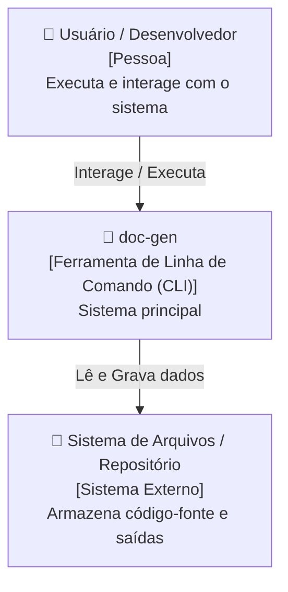
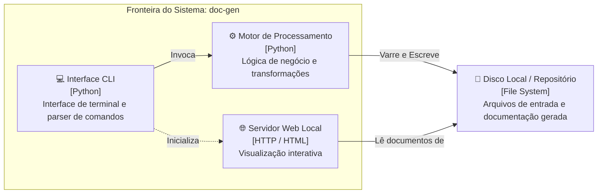
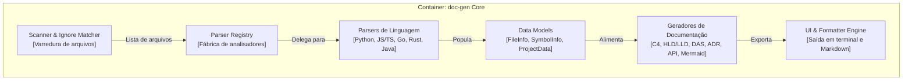

# Modelo C4: doc-gen

> [!NOTE]
> O **Modelo C4** (Context, Containers, Components, Code) fornece uma maneira hierárquica e padronizada de mapear e comunicar a arquitetura de software em diferentes níveis de abstração.

---

## Nível 1: Diagrama de Contexto do Sistema (System Context)

O diagrama de contexto estabelece as fronteiras do sistema, destacando os usuários (atores humanos) e as interações com sistemas e plataformas externas.

### Atores e Fronteiras
- **Usuário / Desenvolvedor**: Opera o sistema doc-gen para realizar tarefas e consultar informações.
- **doc-gen**: O software sob análise, responsável pela lógica principal, orquestração e fluxos.
- **Sistema de Arquivos / Repositório**: Provedor de entrada (código, configurações) e destino de artefatos gerados.

---

## Nível 2: Diagrama de Containers (Containers)

Containers representam as unidades executáveis ou de armazenamento independentes que compõem a solução (aplicações, bancos de dados, serviços, file systems).

### Descrição dos Containers
| Container | Tecnologia | Responsabilidade |
|---|---|---|
| **Interface CLI** | Python / CLI | Receber argumentos do usuário, configurar modos de execução e exibir status formatado. |
| **Motor de Processamento** | Python | Analisar estruturas, parsear ASTs, compilar grafos e gerar relatórios. |
| **Servidor Web Local** | HTTP / HTML5 / JS | Servir e renderizar os documentos Markdown e diagramas interativos localmente. |
| **Disco / Storage** | File System Local | Armazenar fontes, configurações e saídas de documentação. |

---

## Nível 3: Diagrama de Componentes (Components)

Exibe a decomposição interna dos módulos de software que formam o container principal e como eles colaboram entre si.

### Catálogo de Componentes Chave
- **Scanner & Ignore Matcher**: Responsável por navegar recursivamente pelos diretórios, respeitando regras do `.gitignore` e contabilizando linhas de código.
- **Parser Registry & Analyzers**: Fábrica polimórfica que seleciona o parser adequado para cada linguagem e extrai símbolos, classes, métodos e tipos.
- **Data Models**: Dataclasses imutáveis que garantem integridade estrutural em toda a pipeline.
- **Generators Suite**: Conjunto de especialistas em formatar saídas técnicas (C4, HLD, LLD, DAS, ADRs, Glossário DDD e API).

---

## Nível 4: Diagrama de Código (Code / Class Diagram)

Mapeamento das principais classes, interfaces e tipos estruturais que implementam as regras de domínio.

```mermaid
classDiagram
    class IgnoreMatcher {
        +init()
        -load_file()
        +is_ignored() bool
    }
    class RepositoryScanner {
        +init()
        +scan() List
        +calculate_metrics() ProjectMetrics
        +detect_manifests() Tuple
    }
    class SymbolType {
    }
    class ParameterInfo {
        +formatted() str
    }
    class SymbolInfo {
        +signature() str
    }
    class ImportInfo {
    }
    class FileInfo {
    }
    class ModuleGroup {
    }
    class ProjectMetrics {
    }
    class UbiquitousTerm {
    }
    class ProjectData {
    }
    class DocViewerHandler {
        +do_GET()
    }
    class Colors {
    }
    class DocSuiteGenerator {
        +init()
        +generate_all() List
        -build_index() str
        -build_architecture() str
        -build_dependencies() str
        -build_metrics() str
    }
    class BaseParser {
        +can_parse() bool
        +parse() FileInfo
    }
    class JsTsParser {
        +can_parse() bool
        +parse() FileInfo
        -extract_imports()
        -extract_jsdocs() dict
        -parse_ts_params() List
    }
    class GoParser {
        +can_parse() bool
        +parse() FileInfo
        -extract_imports()
        -parse_go_params() list
    }
    class RustParser {
        +can_parse() bool
        +parse() FileInfo
        -parse_rust_params() list
    }
    class JavaParser {
        +can_parse() bool
        +parse() FileInfo
        -parse_params() list
    }
    class GenericParser {
        +can_parse() bool
        +parse() FileInfo
    }
    class PythonParser {
        +can_parse() bool
        +parse() FileInfo
        -extract_import()
        -extract_class() SymbolInfo
        -extract_function() SymbolInfo
    }
    class ParserRegistry {
        +init()
        +parse_file() FileInfo
        +parse_all() List
    }
    class CodebaseContextBuilder {
        +init()
        +build_context() str
    }
    class LLMProvider {
        +generate() str
        +name() str
        +model_name() str
    }
    class GeminiProvider {
        +init()
        +name() str
        +model_name() str
        +generate() str
    }
    BaseParser <|-- JsTsParser
    BaseParser <|-- GoParser
    BaseParser <|-- RustParser
    BaseParser <|-- JavaParser
    BaseParser <|-- GenericParser
    BaseParser <|-- PythonParser
    LLMProvider <|-- GeminiProvider
```

