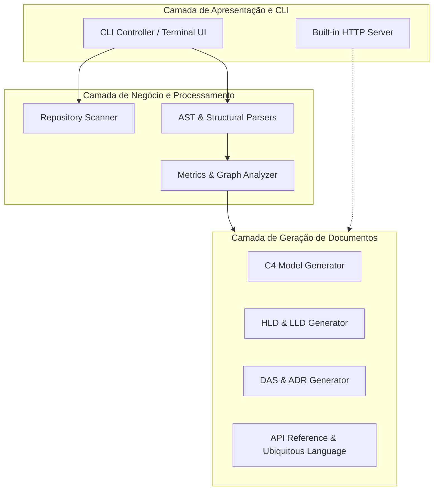

# Documento de Arquitetura de Software (DAS): doc-gen

> [!NOTE]
> Este **Documento de Arquitetura de Software (DAS)** foi estruturado com base nas melhores práticas do padrão **Arc42** e do **Modelo 4+1 Visões de Philippe Kruchten**, registrando decisões, restrições, visões de processo e de implantação.

---

## 1. Introdução e Metas Arquiteturais
O objetivo do software **doc-gen** é fornecer análise estática e geração estruturada de documentação técnica para bases de código heterogêneas.

### Metas de Qualidade Prioritárias
1. **Alta Acurácia**: Extração fidedigna de tipos, classes, funções e comentários de documentação.
2. **Velocidade de Execução**: Varredura ágil mesmo em repositórios de grande porte.
3. **Legibilidade e Riqueza Visual**: Geração de Markdown estruturado com suporte nativo a diagramas Mermaid.

## 2. Restrições e Premissas Arquiteturais
- **Runtime Principal**: Python.
- **Independência de Ambiente**: Compatibilidade direta com ambientes isolados (containers, sandboxes e pipelines de CI/CD).
- **Respeito a Políticas de Código**: Conformidade total com regras de exclusão (`.gitignore`, `.docgenignore`).

## 3. Visão Lógica (Logical View)
Mapeia a organização modular do software e como as responsabilidades são divididas entre os subsistemas:

## 4. Visão de Processo (Process View)
- **Ciclo de Vida Síncrono e Determinístico**: Cada execução do pipeline opera em batch síncrono, garantindo idempotência (a mesma base de código gera o mesmo conjunto de documentações).
- **Uso de Memória**: O modelo `ProjectData` é retido em memória apenas durante o ciclo de execução e liberado após a escrita em disco.

## 5. Visão de Implantação e Execução (Deployment View)
O sistema pode ser distribuído e executado das seguintes maneiras:
1. **Executável Local**: Via CLI empacotada (`docgen`).
2. **Pipeline de CI/CD**: Executado em GitHub Actions, GitLab CI ou Jenkins para atualizar os documentos a cada pull request ou push.
3. **Container Docker**: Executável dentro de imagens base mínimas.

## 6. Riscos Arquiteturais e Mitigações
| Risco Identificado | Impacto | Estratégia de Mitigação |
|---|---|---|
| Arquivos com sintaxe inválida no repositório | Falha durante o parseamento | Parsers implementados com blocos `try/except` resilientes e fallback para `GenericParser`. |
| Repositórios gigantescos com milhões de linhas | Lentidão ou estouro de memória | Limitação de tamanho individual de arquivo (5MB) e poda de diretórios ignorados antes do parse. |
| Falta de tipagem estática no código analisado | Documentação com tipos vazios | Detecção heurística de valores default e docstrings para enriquecer assinaturas. |