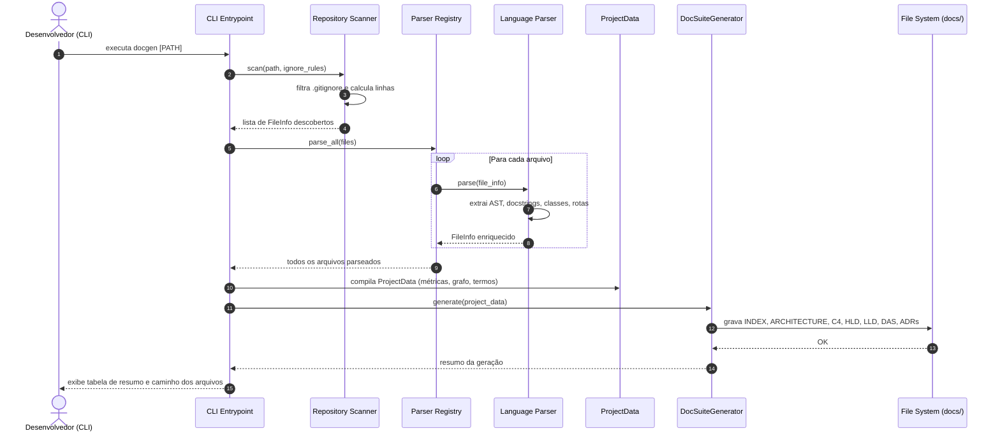

# Low-Level Design (LLD): doc-gen

> [!NOTE]
> O **Low-Level Design (LLD)** detalha as estruturas de dados, assinaturas de contratos, padrões de projeto aplicados e fluxos de execução sequenciais detalhados.

---

## 1. Padrões de Projeto (Design Patterns) Aplicados

### A. Factory Method / Registry Pattern (`ParserRegistry`)
Gerencia a lista de analisadores especializados e instancia o parser correto com base na linguagem ou extensão detectada.

### B. Strategy Pattern (`BaseParser`)
Cada analisador de linguagem (`PythonParser`, `JsTsParser`, `GoParser`, `RustParser`, `JavaParser`, `GenericParser`) implementa a interface comum `BaseParser`, permitindo troca dinâmica de estratégias de parsing.

### C. Builder / Pipeline Pattern (`DocSuiteGenerator`)
Constrói a suíte completa de documentação (`INDEX`, `ARCHITECTURE`, `C4`, `HLD`, `LLD`, `DAS`, `ADRS`, `API`) passo a passo a partir do modelo unificado `ProjectData`.

## 2. Diagrama de Sequência do Fluxo de Execução

## 3. Estruturas de Dados e Entidades do Núcleo
- `FileInfo`: Encapsula caminho relativo, linguagem, contagem de linhas e lista de símbolos extraídos.
- `SymbolInfo`: Modela classes, métodos, interfaces, funções e rotas com assinaturas, docstrings e decoradores.
- `ParameterInfo`: Modela parâmetros formais, tipagem estática e valores default.
- `ProjectData`: Agrega métricas, listas de arquivos, grafos de importação e termos da linguagem ubíqua.