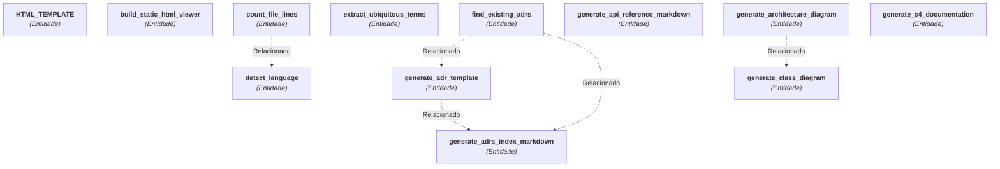

# Linguagem Ubíqua (Glossário DDD): doc-gen

> [!NOTE]
> No **Domain-Driven Design (DDD)**, a **Linguagem Ubíqua** (Ubiquitous Language) é o vocabulário compartilhado e rigoroso utilizado tanto por especialistas de negócio quanto pela equipe técnica para eliminar ambiguidades no software.

---

## 1. Mapa Conceitual do Domínio
Relação visual dos termos mais representativos identificados na base de código:

## 2. Glossário de Termos do Negócio

| Termo / Conceito | Categoria DDD | Definição / Papel no Sistema | Ocorrências |
|---|---|---|---|
| **HTML_TEMPLATE** | `Entidade` | Elemento estrutural do domínio do sistema. | `server.py` |
| **build_static_html_viewer** | `Entidade` | Gera um index.html autossuficiente contendo todos os Markdowns embutidos. | `static_site_generator.py` |
| **count_file_lines** | `Entidade` | Analisa as linhas de um arquivo e retorna:. | `scanner.py` |
| **detect_language** | `Entidade` | Identifica a linguagem pelo nome ou extensão do arquivo. | `scanner.py` |
| **extract_ubiquitous_terms** | `Entidade` | Analisa as definições de classes, tipos e enums para compor a Linguagem Ubíqua. | `ubiquitous_language_generator.py` |
| **find_existing_adrs** | `Entidade` | Procura por ADRs já existentes em pastas comuns. | `adr_generator.py` |
| **generate_adr_template** | `Entidade` | Gera o arquivo de template padrão para novas decisões arquiteturais. | `adr_generator.py` |
| **generate_adrs_index_markdown** | `Entidade` | Gera o índice consolidado de ADRs em Markdown. | `adr_generator.py` |
| **generate_api_reference_markdown** | `Entidade` | Gera o documento API_REFERENCE.md. | `api_reference_generator.py` |
| **generate_architecture_diagram** | `Entidade` | Gera um diagrama de arquitetura em alto nível agrupando módulos em subgraphs. | `mermaid.py` |
| **generate_c4_documentation** | `Entidade` | Gera o documento completo C4_MODEL.md. | `c4_generator.py` |
| **generate_class_diagram** | `Entidade` | Gera um diagrama de classes Mermaid para entidades e classes detectadas. | `mermaid.py` |
| **generate_das** | `Entidade` | Gera o Documento de Arquitetura de Software (DAS.md) no padrão Arc42 / 4+1 Views. | `architecture_generator.py` |
| **generate_dependency_graph** | `Entidade` | Gera o grafo de dependências internas entre módulos do projeto. | `mermaid.py` |
| **generate_directory_tree** | `Entidade` | Gera uma árvore visual de diretórios em texto/ASCII. | `doc_suite.py` |
| **generate_hld** | `Entidade` | Gera o documento High-Level Design (HLD.md). | `architecture_generator.py` |
| **generate_lld** | `Entidade` | Gera o documento Low-Level Design (LLD.md). | `architecture_generator.py` |
| **generate_ubiquitous_language_markdown** | `Entidade` | Gera o documento UBIQUITOUS_LANGUAGE.md. | `ubiquitous_language_generator.py` |
| **get_primary_programming_language** | `Entidade` | Retorna a linguagem de programação principal, desconsiderando arquivos de doc/config. | `config.py` |
| **print_banner** | `Entidade` | Exibe o cabeçalho estilizado do DocGen. | `ui.py` |
| **print_error** | `Entidade` | Imprime erro. | `ui.py` |
| **print_info** | `Entidade` | Imprime mensagem informativa. | `ui.py` |
| **print_step** | `Entidade` | Imprime uma etapa do processo. | `ui.py` |
| **print_success** | `Entidade` | Imprime confirmação de sucesso. | `ui.py` |
| **print_table** | `Entidade` | Renderiza uma tabela formatada com bordas Unicode no terminal. | `ui.py` |
| **print_warning** | `Entidade` | Imprime aviso. | `ui.py` |
| **resolve_internal_dependencies** | `Entidade` | Mapeia os imports internos entre arquivos do projeto. | `cli.py` |
| **run_generate** | `Entidade` | Executa a análise do repositório e a geração completa da documentação. | `cli.py` |
| **run_init** | `Entidade` | Inicializa arquivos de configuração padrão. | `cli.py` |
| **run_stats** | `Entidade` | Apenas analisa e exibe métricas no terminal. | `cli.py` |
| **sanitize_id** | `Entidade` | Sanitiza strings para identificadores válidos em nós Mermaid. | `mermaid.py` |
| **start_doc_server** | `Entidade` | Inicia o servidor de visualização local. | `server.py` |
| **synthesize_project_adrs** | `Entidade` | Gera ADRs sintetizados representativos do repositório se nenhum for encontrado. | `adr_generator.py` |
| **ADRItem** | `Entidade de Domínio` | Entidade central com ciclo de vida e estado gerenciado em ADRItem. | `models.py` |
| **BaseParser** | `Entidade de Domínio` | Contrato base para analisadores de código fonte. | `base.py` |
| **Colors** | `Entidade de Domínio` | Entidade central com ciclo de vida e estado gerenciado em Colors. | `ui.py` |
| **GenericParser** | `Entidade de Domínio` | Parser de fallback para qualquer arquivo de código ou configuração. | `generic_parser.py` |
| **GoParser** | `Entidade de Domínio` | Parser estrutural para código Go. | `go_parser.py` |
| **IgnoreMatcher** | `Entidade de Domínio` | Implementa correspondência de padrões estilo .gitignore. | `scanner.py` |
| **JavaParser** | `Entidade de Domínio` | Parser para linguagens orientadas a objetos baseadas em classes (Java, C#, Kotlin). | `java_parser.py` |
| **JsTsParser** | `Entidade de Domínio` | Parser estrutural e regex para JavaScript e TypeScript. | `js_ts_parser.py` |
| **ModuleGroup** | `Entidade de Domínio` | Entidade central com ciclo de vida e estado gerenciado em ModuleGroup. | `models.py` |
| **PythonParser** | `Entidade de Domínio` | Parser para arquivos Python usando AST. | `python_parser.py` |
| **RustParser** | `Entidade de Domínio` | Parser estrutural para código Rust. | `rust_parser.py` |
| **SymbolType** | `Entidade de Domínio` | Entidade central com ciclo de vida e estado gerenciado em SymbolType. | `models.py` |
| **TestCLI** | `Entidade de Domínio` | Entidade central com ciclo de vida e estado gerenciado em TestCLI. | `test_cli.py` |
| **TestJsTsParser** | `Entidade de Domínio` | Entidade central com ciclo de vida e estado gerenciado em TestJsTsParser. | `test_js_parser.py` |
| **TestPythonParser** | `Entidade de Domínio` | Entidade central com ciclo de vida e estado gerenciado em TestPythonParser. | `test_python_parser.py` |
| **UbiquitousTerm** | `Entidade de Domínio` | Entidade central com ciclo de vida e estado gerenciado em UbiquitousTerm. | `models.py` |
| **FileInfo** | `Objeto de Valor (Value Object)` | Representação imutável com propriedades e métricas de FileInfo. | `models.py` |
| **ImportInfo** | `Objeto de Valor (Value Object)` | Representação imutável com propriedades e métricas de ImportInfo. | `models.py` |
| **ParameterInfo** | `Objeto de Valor (Value Object)` | Representação imutável com propriedades e métricas de ParameterInfo. | `models.py` |
| **ProjectData** | `Objeto de Valor (Value Object)` | Representação imutável com propriedades e métricas de ProjectData. | `models.py` |
| **ProjectMetrics** | `Objeto de Valor (Value Object)` | Representação imutável com propriedades e métricas de ProjectMetrics. | `models.py` |
| **SymbolInfo** | `Objeto de Valor (Value Object)` | Representação imutável com propriedades e métricas de SymbolInfo. | `models.py` |
| **DocSuiteGenerator** | `Serviço de Domínio` | Orquestra a escrita dos documentos Markdown. | `doc_suite.py` |
| **DocViewerHandler** | `Serviço de Domínio` | Handler HTTP para servir a UI interativa e os arquivos Markdown. | `server.py` |
| **ParserRegistry** | `Serviço de Domínio` | Gerencia a lista de parsers disponíveis e aplica o mais adequado a cada arquivo. | `__init__.py` |
| **RepositoryScanner** | `Serviço de Domínio` | Escaneia o repositório e constrói a lista inicial de arquivos e métricas. | `scanner.py` |
| **TestGenerators** | `Serviço de Domínio` | Serviço responsável por executar operações e orquestrações de TestGenerators. | `test_generators.py` |
| **TestScanner** | `Serviço de Domínio` | Serviço responsável por executar operações e orquestrações de TestScanner. | `test_scanner.py` |

---

### Entidade (33)
- **HTML_TEMPLATE**: Elemento estrutural do domínio do sistema.
  - *Arquivos*: `docgen/server.py`
- **build_static_html_viewer**: Gera um index.html autossuficiente contendo todos os Markdowns embutidos.
  - *Arquivos*: `docgen/generators/static_site_generator.py`
- **count_file_lines**: Analisa as linhas de um arquivo e retorna:.
  - *Arquivos*: `docgen/scanner.py`
- **detect_language**: Identifica a linguagem pelo nome ou extensão do arquivo.
  - *Arquivos*: `docgen/scanner.py`
- **extract_ubiquitous_terms**: Analisa as definições de classes, tipos e enums para compor a Linguagem Ubíqua.
  - *Arquivos*: `docgen/generators/ubiquitous_language_generator.py`
- **find_existing_adrs**: Procura por ADRs já existentes em pastas comuns.
  - *Arquivos*: `docgen/generators/adr_generator.py`
- **generate_adr_template**: Gera o arquivo de template padrão para novas decisões arquiteturais.
  - *Arquivos*: `docgen/generators/adr_generator.py`
- **generate_adrs_index_markdown**: Gera o índice consolidado de ADRs em Markdown.
  - *Arquivos*: `docgen/generators/adr_generator.py`
- **generate_api_reference_markdown**: Gera o documento API_REFERENCE.md.
  - *Arquivos*: `docgen/generators/api_reference_generator.py`
- **generate_architecture_diagram**: Gera um diagrama de arquitetura em alto nível agrupando módulos em subgraphs.
  - *Arquivos*: `docgen/generators/mermaid.py`
- **generate_c4_documentation**: Gera o documento completo C4_MODEL.md.
  - *Arquivos*: `docgen/generators/c4_generator.py`
- **generate_class_diagram**: Gera um diagrama de classes Mermaid para entidades e classes detectadas.
  - *Arquivos*: `docgen/generators/mermaid.py`
- **generate_das**: Gera o Documento de Arquitetura de Software (DAS.md) no padrão Arc42 / 4+1 Views.
  - *Arquivos*: `docgen/generators/architecture_generator.py`
- **generate_dependency_graph**: Gera o grafo de dependências internas entre módulos do projeto.
  - *Arquivos*: `docgen/generators/mermaid.py`
- **generate_directory_tree**: Gera uma árvore visual de diretórios em texto/ASCII.
  - *Arquivos*: `docgen/generators/doc_suite.py`
- **generate_hld**: Gera o documento High-Level Design (HLD.md).
  - *Arquivos*: `docgen/generators/architecture_generator.py`
- **generate_lld**: Gera o documento Low-Level Design (LLD.md).
  - *Arquivos*: `docgen/generators/architecture_generator.py`
- **generate_ubiquitous_language_markdown**: Gera o documento UBIQUITOUS_LANGUAGE.md.
  - *Arquivos*: `docgen/generators/ubiquitous_language_generator.py`
- **get_primary_programming_language**: Retorna a linguagem de programação principal, desconsiderando arquivos de doc/config.
  - *Arquivos*: `docgen/config.py`
- **print_banner**: Exibe o cabeçalho estilizado do DocGen.
  - *Arquivos*: `docgen/ui.py`
- **print_error**: Imprime erro.
  - *Arquivos*: `docgen/ui.py`
- **print_info**: Imprime mensagem informativa.
  - *Arquivos*: `docgen/ui.py`
- **print_step**: Imprime uma etapa do processo.
  - *Arquivos*: `docgen/ui.py`
- **print_success**: Imprime confirmação de sucesso.
  - *Arquivos*: `docgen/ui.py`
- **print_table**: Renderiza uma tabela formatada com bordas Unicode no terminal.
  - *Arquivos*: `docgen/ui.py`
- **print_warning**: Imprime aviso.
  - *Arquivos*: `docgen/ui.py`
- **resolve_internal_dependencies**: Mapeia os imports internos entre arquivos do projeto.
  - *Arquivos*: `docgen/cli.py`
- **run_generate**: Executa a análise do repositório e a geração completa da documentação.
  - *Arquivos*: `docgen/cli.py`
- **run_init**: Inicializa arquivos de configuração padrão.
  - *Arquivos*: `docgen/cli.py`
- **run_stats**: Apenas analisa e exibe métricas no terminal.
  - *Arquivos*: `docgen/cli.py`
- **sanitize_id**: Sanitiza strings para identificadores válidos em nós Mermaid.
  - *Arquivos*: `docgen/generators/mermaid.py`
- **start_doc_server**: Inicia o servidor de visualização local.
  - *Arquivos*: `docgen/server.py`
- **synthesize_project_adrs**: Gera ADRs sintetizados representativos do repositório se nenhum for encontrado.
  - *Arquivos*: `docgen/generators/adr_generator.py`

### Entidade de Domínio (16)
- **ADRItem**: Entidade central com ciclo de vida e estado gerenciado em ADRItem.
  - *Arquivos*: `docgen/models.py`
- **BaseParser**: Contrato base para analisadores de código fonte.
  - *Arquivos*: `docgen/parsers/base.py`
- **Colors**: Entidade central com ciclo de vida e estado gerenciado em Colors.
  - *Arquivos*: `docgen/ui.py`
- **GenericParser**: Parser de fallback para qualquer arquivo de código ou configuração.
  - *Arquivos*: `docgen/parsers/generic_parser.py`
- **GoParser**: Parser estrutural para código Go.
  - *Arquivos*: `docgen/parsers/go_parser.py`
- **IgnoreMatcher**: Implementa correspondência de padrões estilo .gitignore.
  - *Arquivos*: `docgen/scanner.py`
- **JavaParser**: Parser para linguagens orientadas a objetos baseadas em classes (Java, C#, Kotlin).
  - *Arquivos*: `docgen/parsers/java_parser.py`
- **JsTsParser**: Parser estrutural e regex para JavaScript e TypeScript.
  - *Arquivos*: `docgen/parsers/js_ts_parser.py`
- **ModuleGroup**: Entidade central com ciclo de vida e estado gerenciado em ModuleGroup.
  - *Arquivos*: `docgen/models.py`
- **PythonParser**: Parser para arquivos Python usando AST.
  - *Arquivos*: `docgen/parsers/python_parser.py`
- **RustParser**: Parser estrutural para código Rust.
  - *Arquivos*: `docgen/parsers/rust_parser.py`
- **SymbolType**: Entidade central com ciclo de vida e estado gerenciado em SymbolType.
  - *Arquivos*: `docgen/models.py`
- **TestCLI**: Entidade central com ciclo de vida e estado gerenciado em TestCLI.
  - *Arquivos*: `tests/test_cli.py`
- **TestJsTsParser**: Entidade central com ciclo de vida e estado gerenciado em TestJsTsParser.
  - *Arquivos*: `tests/test_js_parser.py`
- **TestPythonParser**: Entidade central com ciclo de vida e estado gerenciado em TestPythonParser.
  - *Arquivos*: `tests/test_python_parser.py`
- **UbiquitousTerm**: Entidade central com ciclo de vida e estado gerenciado em UbiquitousTerm.
  - *Arquivos*: `docgen/models.py`

### Objeto de Valor (Value Object) (6)
- **FileInfo**: Representação imutável com propriedades e métricas de FileInfo.
  - *Arquivos*: `docgen/models.py`
- **ImportInfo**: Representação imutável com propriedades e métricas de ImportInfo.
  - *Arquivos*: `docgen/models.py`
- **ParameterInfo**: Representação imutável com propriedades e métricas de ParameterInfo.
  - *Arquivos*: `docgen/models.py`
- **ProjectData**: Representação imutável com propriedades e métricas de ProjectData.
  - *Arquivos*: `docgen/models.py`
- **ProjectMetrics**: Representação imutável com propriedades e métricas de ProjectMetrics.
  - *Arquivos*: `docgen/models.py`
- **SymbolInfo**: Representação imutável com propriedades e métricas de SymbolInfo.
  - *Arquivos*: `docgen/models.py`

### Serviço de Domínio (6)
- **DocSuiteGenerator**: Orquestra a escrita dos documentos Markdown.
  - *Arquivos*: `docgen/generators/doc_suite.py`
- **DocViewerHandler**: Handler HTTP para servir a UI interativa e os arquivos Markdown.
  - *Arquivos*: `docgen/server.py`
- **ParserRegistry**: Gerencia a lista de parsers disponíveis e aplica o mais adequado a cada arquivo.
  - *Arquivos*: `docgen/parsers/__init__.py`
- **RepositoryScanner**: Escaneia o repositório e constrói a lista inicial de arquivos e métricas.
  - *Arquivos*: `docgen/scanner.py`
- **TestGenerators**: Serviço responsável por executar operações e orquestrações de TestGenerators.
  - *Arquivos*: `tests/test_generators.py`
- **TestScanner**: Serviço responsável por executar operações e orquestrações de TestScanner.
  - *Arquivos*: `tests/test_scanner.py`
